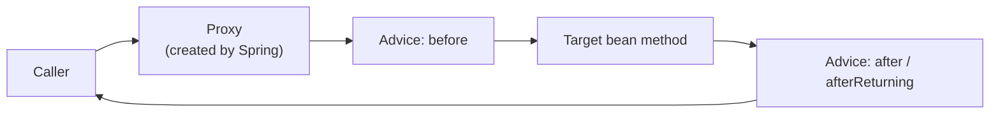
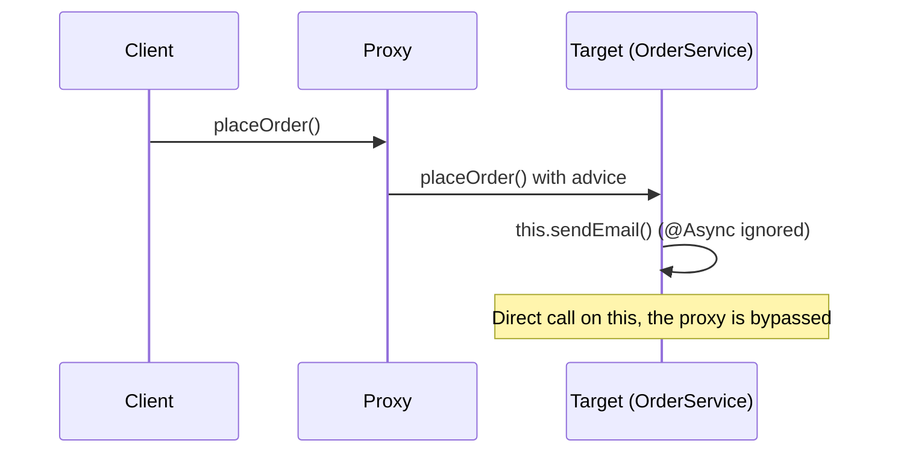
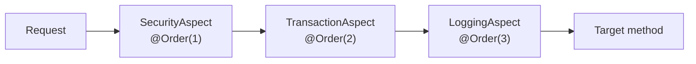
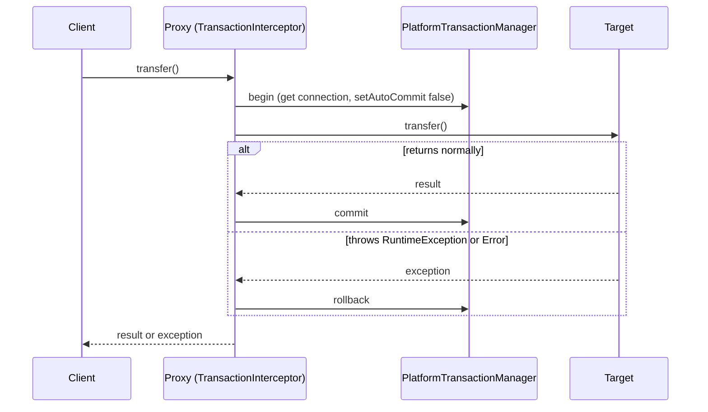

## Beginner

### Q: What is AOP and why do we need it? Explain aspect, join point, pointcut, advice and weaving. {theory}
Aspect-Oriented Programming separates **cross-cutting concerns** (logging, security, transactions, metrics, caching) from business logic, so they are written once and applied declaratively instead of being copied into every method.

- **Aspect:** a class that packages a cross-cutting concern (`@Aspect`).
- **Join point:** a point in execution where an aspect can apply. In Spring AOP it is always a **method execution** on a Spring bean.
- **Pointcut:** an expression that selects which join points to match.
- **Advice:** the code that runs at the matched join point (before, after, around...).
- **Weaving:** linking aspects with target objects. Spring AOP weaves at **runtime** using proxies.
- **Target:** the original bean being advised. **Proxy:** the object Spring puts in front of it.



### Q: What are the types of advice in Spring AOP? {theory}
- `@Before`: runs before the method. Cannot stop it, except by throwing an exception.
- `@AfterReturning`: runs after normal return; can read the return value.
- `@AfterThrowing`: runs when the method throws; can read the exception.
- `@After` (finally): runs after the method however it ends.
- `@Around`: wraps the call. It receives a `ProceedingJoinPoint`, decides whether and when to call `proceed()`, and can change arguments or the result. It is the most powerful and what `@Transactional`, `@Cacheable` and retry logic use.

Prefer the **least powerful** advice that does the job: an `@Before` check is harder to get wrong than an `@Around` that forgets to call `proceed()`.

### Q: Write an aspect that logs the execution time of every public method in the service package. {coding}
```java
@Aspect
@Component
public class TimingAspect {
    private static final Logger log = LoggerFactory.getLogger(TimingAspect.class);

    @Around("execution(public * com.shop.service..*(..))")
    public Object time(ProceedingJoinPoint pjp) throws Throwable {
        long start = System.nanoTime();
        try {
            return pjp.proceed();                       // call the real method
        } finally {
            long ms = (System.nanoTime() - start) / 1_000_000;
            log.info("{} took {} ms", pjp.getSignature().toShortString(), ms);
        }
    }
}
```

Reading the pointcut: `execution(modifiers? return-type declaring-type? method(args) throws?)`. Here: any public method, any return type, in `com.shop.service` and its sub-packages (`..`), any arguments. Always rethrow exceptions (`throws Throwable`) so you do not swallow them. In Spring Boot, `spring-boot-starter-aop` supplies AspectJ's annotations and enables proxying automatically.

## Intermediate

### Q: How does Spring AOP work internally? JDK dynamic proxy vs CGLIB. {theory}
At startup an auto-proxy creator (a `BeanPostProcessor`) checks each bean against all pointcuts. If any advice matches, it replaces the bean with a **proxy** that runs the advice chain and then delegates to the target.

| | JDK dynamic proxy | CGLIB proxy |
|---|---|---|
| Mechanism | Implements the bean's interfaces | Generates a **subclass** of the bean |
| Needs | At least one interface | A non-final class and non-final methods |
| Injection by | Interface type only | Interface or class type |

Spring Boot sets `spring.aop.proxy-target-class=true` by default, so **CGLIB is used even for beans with interfaces**. This avoids `ClassCastException` when something injects the concrete class.

### Q: What is the difference between Spring AOP and AspectJ? {theory}
| | Spring AOP | AspectJ |
|---|---|---|
| Weaving | Runtime, proxy-based | Compile-time, post-compile or load-time bytecode weaving |
| Join points | Method execution on Spring beans only | Methods, constructors, field access, static init, any object |
| Setup | Simple, no special compiler | Needs the AspectJ compiler or a weaving agent |
| Performance | Small proxy overhead per call | Faster at runtime, no proxy |
| Limits | Self-invocation, final/private methods not advised | Few limits |

Use Spring AOP for the common 90% (transactions, security, logging on beans). Choose AspectJ when you must advise non-Spring objects, constructors, field access or avoid the self-invocation problem.

### Q: How do you create a custom annotation and an aspect that reacts to it? {coding}
Annotation-driven pointcuts are clearer and safer than package-based ones. Example: audit every method marked `@Audited`.

```java
@Target(ElementType.METHOD)
@Retention(RetentionPolicy.RUNTIME)
public @interface Audited {
    String action();
}

@Aspect
@Component
class AuditAspect {
    private final AuditLog auditLog;
    AuditAspect(AuditLog auditLog) { this.auditLog = auditLog; }

    @Around("@annotation(audited)")                    // binds the annotation instance
    Object audit(ProceedingJoinPoint pjp, Audited audited) throws Throwable {
        String user = SecurityContextHolder.getContext().getAuthentication().getName();
        try {
            Object result = pjp.proceed();
            auditLog.record(user, audited.action(), "SUCCESS");
            return result;
        } catch (Throwable ex) {
            auditLog.record(user, audited.action(), "FAILED: " + ex.getMessage());
            throw ex;                                  // never swallow
        }
    }
}

@Service
class AccountService {
    @Audited(action = "CLOSE_ACCOUNT")
    public void close(Long id) { /* ... */ }
}
```

## Experienced

### Q: My @Transactional (or @Async, @Cacheable) method is ignored when called from another method in the same class. Why, and how do you fix it? {scenario}
This is the **self-invocation problem**. Advice lives in the proxy. A call from outside goes through the proxy, but a call from one method to another on `this` goes straight to the target object and bypasses the proxy entirely.



Fixes, in order of preference:

1. **Move the method to another bean** and inject it. The call then crosses a proxy. This is the cleanest design.
2. Inject the bean's own proxy (`@Lazy` self-injection) and call through it. Works but is awkward.
3. Use AspectJ mode (`@EnableTransactionManagement(mode = AdviceMode.ASPECTJ)`) so weaving changes the bytecode itself.

Related limits: `private`, `final` and `static` methods are not advised by CGLIB proxies. Before Spring 6, `@Transactional` was also ignored on `protected` and package-private methods; with class-based proxies Spring 6 supports them, but `private` methods are still never advised.

### Q: Multiple aspects apply to the same method. How is the order decided, and how do exceptions flow through @Around advice? {theory}
Order is controlled by `@Order(n)` on the aspect class (or implementing `Ordered`). **Lower value = higher precedence**: its "before" part runs first and its "after" part runs last, like nested onions.



Practical consequences:

- Put security outermost so an unauthorized call never opens a transaction.
- Put retry **outside** the transaction advice, otherwise a retry reuses a transaction already marked rollback-only.
- Without `@Order`, the order is undefined, so never rely on it.
- An exception travels back outward through each `@Around`. If an advice catches it and returns normally, the outer advice (and the caller) see success. This is how `@Transactional` ends up not rolling back when an inner aspect swallows the exception.

### Q: Implement a retry mechanism with an annotation, and explain what you must watch for. {coding}
```java
@Target(ElementType.METHOD) @Retention(RetentionPolicy.RUNTIME)
public @interface Retry { int attempts() default 3; long backoffMs() default 200; }

@Aspect @Component @Order(Ordered.HIGHEST_PRECEDENCE)   // outside @Transactional
class RetryAspect {
    @Around("@annotation(retry)")
    Object around(ProceedingJoinPoint pjp, Retry retry) throws Throwable {
        Throwable last = null;
        for (int i = 1; i <= retry.attempts(); i++) {
            try {
                return pjp.proceed();
            } catch (TransientDataAccessException | SocketTimeoutException ex) { // retry only transient errors
                last = ex;
                Thread.sleep(retry.backoffMs() * i);                              // linear backoff
            }
        }
        throw last;
    }
}
```

Watch for: retrying only **idempotent** operations or transient failures; adding jitter and a cap to avoid retry storms; keeping the aspect outside the transaction; and not retrying validation or business exceptions. In production prefer **Spring Retry** (`@Retryable`) or Resilience4j, which implement these concerns, plus circuit breakers.

### Q: How is @Transactional implemented with AOP? What happens on an exception? {theory}
`@Transactional` is handled by `TransactionInterceptor`, an `@Around`-style advice installed on a proxy.



Default rollback rule: **rollback on unchecked exceptions (`RuntimeException`, `Error`) only**. A checked exception commits unless you declare `@Transactional(rollbackFor = Exception.class)`. Because it is proxy-based, self-invocation, non-public methods and swallowed exceptions all defeat it (see the self-invocation question).

### Q: Design a cross-cutting solution for API rate limiting and request auditing across 40 microservices without copying code. {design}
Put the cross-cutting concern in a **shared library** and apply it declaratively.

- A starter module `platform-audit-starter` contains the `@Audited` annotation, the aspect and an auto-configuration registered in `META-INF/spring/org.springframework.boot.autoconfigure.AutoConfiguration.imports`. Services only add the dependency.
- Make aspects conditional (`@ConditionalOnProperty`) so teams can disable them per environment.
- Keep aspects thin and **non-blocking**: write audit events to an async queue/Kafka topic instead of the database inside the request path.
- For rate limiting that must be consistent across instances, do not use an in-memory aspect alone. Enforce it at the **API gateway** or use a shared store (Redis token bucket). An aspect is fine for per-instance protection of an expensive method.

Trade-off to state in an interview: AOP is great for uniform, orthogonal behavior, but hides control flow. Keep aspects small, well-named and covered by tests (use `@SpringBootTest` or a slice with `@EnableAspectJAutoProxy`), and prefer explicit code when the behavior is business logic.
