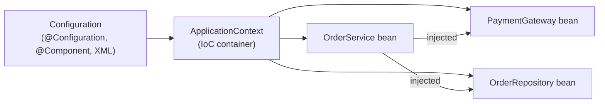
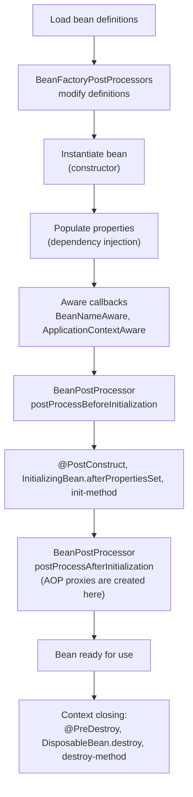
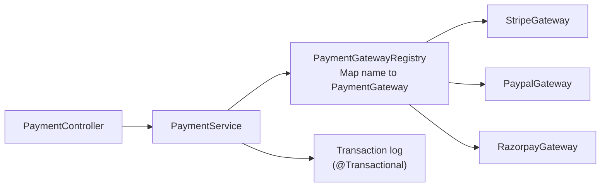

## Beginner

### Q: What is Inversion of Control (IoC) and Dependency Injection (DI) in Spring? {theory}
With IoC, the framework, not your code, creates objects and wires them together. Normally a class does `new PaymentGateway()` itself, which couples it to one implementation. With IoC the class only declares what it needs and the Spring container supplies it.

DI is the technique Spring uses to do this: dependencies are *injected* through a constructor, setter or field.

- **Benefits:** loose coupling, easy unit testing (pass a mock), easy swapping of implementations, and lifecycle and cross-cutting concerns managed in one place.
- **The container:** `ApplicationContext` reads configuration (annotations, Java config, XML), creates beans, injects dependencies and manages their lifecycle.



### Q: What are the types of dependency injection and which one should you prefer? {theory}
Spring supports three styles:

- **Constructor injection:** dependencies are constructor parameters. Preferred.
- **Setter injection:** dependencies are set through setter methods. Good for optional dependencies.
- **Field injection:** `@Autowired` directly on a field. Avoid in application code.

Constructor injection is preferred because dependencies can be `final` (immutable), the object can never exist half-built, missing dependencies fail at startup, it is easy to unit test without Spring (`new OrderService(mockRepo)`), and an overly large constructor is a visible smell for a class doing too much. Field injection hides all of this and needs reflection or Spring to test.

```java
@Service
public class OrderService {
    private final OrderRepository repo;
    private final PaymentGateway gateway;

    // @Autowired is optional when there is a single constructor
    public OrderService(OrderRepository repo, PaymentGateway gateway) {
        this.repo = repo;
        this.gateway = gateway;
    }
}
```

### Q: What are the bean scopes in Spring? {theory}
The scope controls how many instances the container creates.

| Scope | Instances | Notes |
|---|---|---|
| `singleton` (default) | One per container | Shared, so it must be thread-safe and effectively stateless |
| `prototype` | New one on each request for the bean | Spring does not call destroy callbacks |
| `request` | One per HTTP request | Web-aware contexts only |
| `session` | One per HTTP session | Web-aware contexts only |
| `application` | One per ServletContext | Web-aware contexts only |
| `websocket` | One per WebSocket session | Web-aware contexts only |

Singleton means one instance per container, not one per JVM like the GoF pattern.

### Q: What is the difference between @Component, @Service, @Repository and @Controller? And @Bean vs @Component? {theory}
`@Component` is the generic stereotype that marks a class for component scanning. `@Service`, `@Repository` and `@Controller` are specializations with the same registration behavior but clearer intent:

- `@Repository` also enables exception translation (vendor exceptions become Spring's `DataAccessException` hierarchy).
- `@Controller` is detected by Spring MVC for request mapping.
- `@Service` has no extra behavior; it documents the layer.

`@Component` is **class-level** and found by scanning. `@Bean` is **method-level**, inside a `@Configuration` class, and you write the construction code yourself. Use `@Bean` for classes you do not own (a third-party `ObjectMapper`, `DataSource`) or when creation needs logic.

```java
@Configuration
public class AppConfig {
    @Bean
    public Clock clock() { return Clock.systemUTC(); }
}
```

## Intermediate

### Q: What is the difference between BeanFactory and ApplicationContext? {theory}
`BeanFactory` is the basic container: it creates beans lazily and supports DI. `ApplicationContext` extends it and is what you use in practice. It adds:

- eager creation of singletons at startup, so configuration errors surface immediately
- event publication (`ApplicationEventPublisher`)
- internationalization (`MessageSource`)
- resource loading and environment/profile support
- automatic registration of `BeanPostProcessor` and `BeanFactoryPostProcessor`
- integration with AOP and web contexts

### Q: Explain the Spring bean lifecycle. {theory}
For a singleton bean the container does the following:



Key interview points: injection happens *before* `@PostConstruct`, so the init method can safely use injected fields; AOP proxies are produced in `postProcessAfterInitialization`; prototype beans are not destroyed by the container.

### Q: How does Spring resolve which bean to inject? What if there are multiple candidates? {coding}
Spring autowires **by type** first. If more than one bean matches, it narrows by `@Primary`, then `@Qualifier`, then falls back to matching the parameter or field **name** to a bean name. If still ambiguous it throws `NoUniqueBeanDefinitionException`. If none match it throws `NoSuchBeanDefinitionException` (unless the dependency is optional).

```java
public interface PaymentGateway { void pay(Money m); }

@Component @Primary
class StripeGateway implements PaymentGateway { /* ... */ }

@Component("paypal")
class PaypalGateway implements PaymentGateway { /* ... */ }

@Service
class CheckoutService {
    CheckoutService(PaymentGateway defaultGateway,                 // StripeGateway (@Primary)
                    @Qualifier("paypal") PaymentGateway paypal) {} // explicit choice
}
```

To inject *all* implementations, ask for `List<PaymentGateway>` or `Map<String, PaymentGateway>` (bean name to bean). This is the usual way to build a strategy registry.

### Q: What are circular dependencies and how does Spring handle them? {scenario}
A circular dependency is when A needs B and B needs A. With constructor injection neither can be created first, so Spring throws `BeanCurrentlyInCreationException`. Setter or field injection on singletons used to work because Spring exposes an early reference from its three-level singleton cache. **Since Spring Boot 2.6 circular references are prohibited by default** (`spring.main.allow-circular-references=false`).

Treat a cycle as a design smell, not something to switch back on. Fixes, best first:

1. Extract the shared behavior into a third class both depend on, or move one responsibility.
2. Invert one direction with an event (`ApplicationEventPublisher`) or an interface.
3. As a last resort, break the cycle with `@Lazy` on one constructor parameter, which injects a lazy proxy.

```java
@Service
class A {
    A(@Lazy B b) { this.b = b; }   // B is resolved on first use
    private final B b;
}
```

## Experienced

### Q: A singleton bean needs a new instance of a prototype bean on every call. Why does plain injection not work and what are the options? {coding}
The singleton is created once, so its prototype dependency is injected once and then reused forever. The prototype scope is effectively lost.

Options:

- **`ObjectProvider<T>`** (recommended): call `getObject()` each time to get a fresh instance.
- **`@Lookup`** method injection: Spring overrides the method (CGLIB) to return a new bean each call.
- **Scoped proxy**: `@Scope(value = "prototype", proxyMode = ScopedProxyMode.TARGET_CLASS)` injects a proxy that resolves the real bean per call.

```java
@Component @Scope("prototype")
class ReportBuilder { /* holds per-report state */ }

@Service
class ReportService {
    private final ObjectProvider<ReportBuilder> builders;
    ReportService(ObjectProvider<ReportBuilder> builders) { this.builders = builders; }

    Report generate() {
        ReportBuilder b = builders.getObject();   // new instance every call
        return b.build();
    }
}
```

The same issue appears with `request` and `session` scoped beans injected into singletons, which is why those need scoped proxies.

### Q: What is the difference between @Configuration "full" mode and "lite" mode, and what does proxyBeanMethods do? {theory}
Spring subclasses a `@Configuration` class with CGLIB so that calling one `@Bean` method from another returns the **existing singleton** rather than creating a new object. That is "full" mode.

```java
@Configuration   // proxyBeanMethods = true by default
class Config {
    @Bean A a() { return new A(b()); }   // b() returns the container's singleton B
    @Bean B b() { return new B(); }
}
```

With `@Configuration(proxyBeanMethods = false)` (also called lite mode, and how `@Component` or plain classes with `@Bean` behave) no proxy is created, so `b()` would build a new `B`. Lite mode starts faster and uses less memory and is what Spring Boot's own auto-configurations use. Use it when your `@Bean` methods do not call each other, and take dependencies as method parameters instead:

```java
@Bean A a(B b) { return new A(b); }
```

### Q: How do Spring application events work, and why use @TransactionalEventListener? {coding}
`ApplicationEventPublisher` lets beans publish events that other beans consume with `@EventListener`, decoupling producers from consumers inside one application. Listeners run **synchronously on the publisher's thread** by default, unless the listener is also `@Async`.

```java
record OrderPlaced(Long orderId) {}

@Service
class OrderService {
    private final ApplicationEventPublisher events;
    private final OrderRepository repo;
    OrderService(ApplicationEventPublisher events, OrderRepository repo) { this.events = events; this.repo = repo; }

    @Transactional
    public void place(Order o) {
        repo.save(o);
        events.publishEvent(new OrderPlaced(o.getId()));
    }
}

@Component
class EmailListener {
    @TransactionalEventListener(phase = TransactionPhase.AFTER_COMMIT)
    @Async
    void on(OrderPlaced e) { /* send confirmation email */ }
}
```

A plain `@EventListener` would send the email even if the transaction later rolls back. `@TransactionalEventListener(AFTER_COMMIT)` fires only after a successful commit. Caveat: the event is lost if the process crashes between commit and handling, so for guaranteed delivery to other systems use the transactional outbox pattern instead.

### Q: Design a payment module where the provider (Stripe, PayPal, Razorpay) is chosen per request and new providers can be added without changing existing code. {design}
Use the **strategy pattern** with Spring collecting all implementations.



```java
public interface PaymentGateway {
    String provider();                       // "stripe", "paypal"
    PaymentResult charge(PaymentRequest r);
}

@Component
class PaymentGatewayRegistry {
    private final Map<String, PaymentGateway> byProvider;

    PaymentGatewayRegistry(List<PaymentGateway> gateways) {   // Spring injects all implementations
        this.byProvider = gateways.stream()
            .collect(Collectors.toMap(PaymentGateway::provider, Function.identity()));
    }

    PaymentGateway get(String provider) {
        PaymentGateway g = byProvider.get(provider);
        if (g == null) throw new UnsupportedProviderException(provider);
        return g;
    }
}
```

Adding a provider means adding one new `@Component`: no `if/else` chain changes (open/closed principle). Enable or disable providers per environment with `@ConditionalOnProperty`, and wrap each gateway call with timeouts, retries and a circuit breaker.
