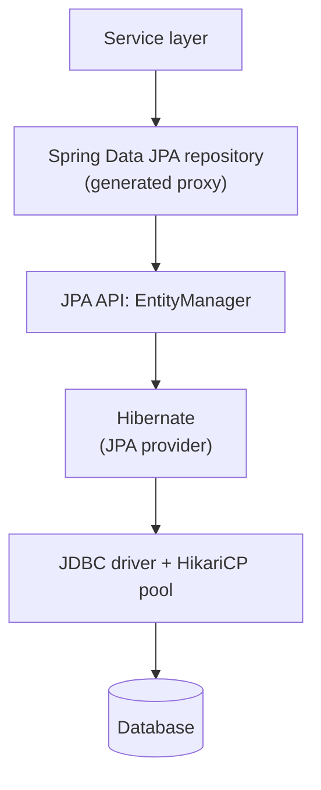
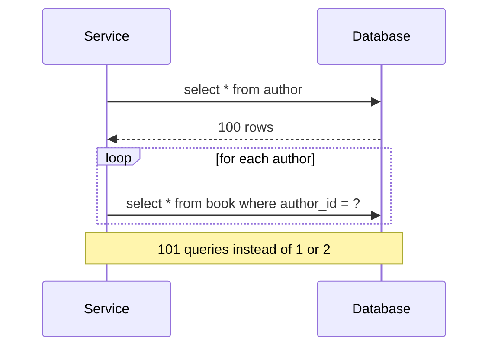
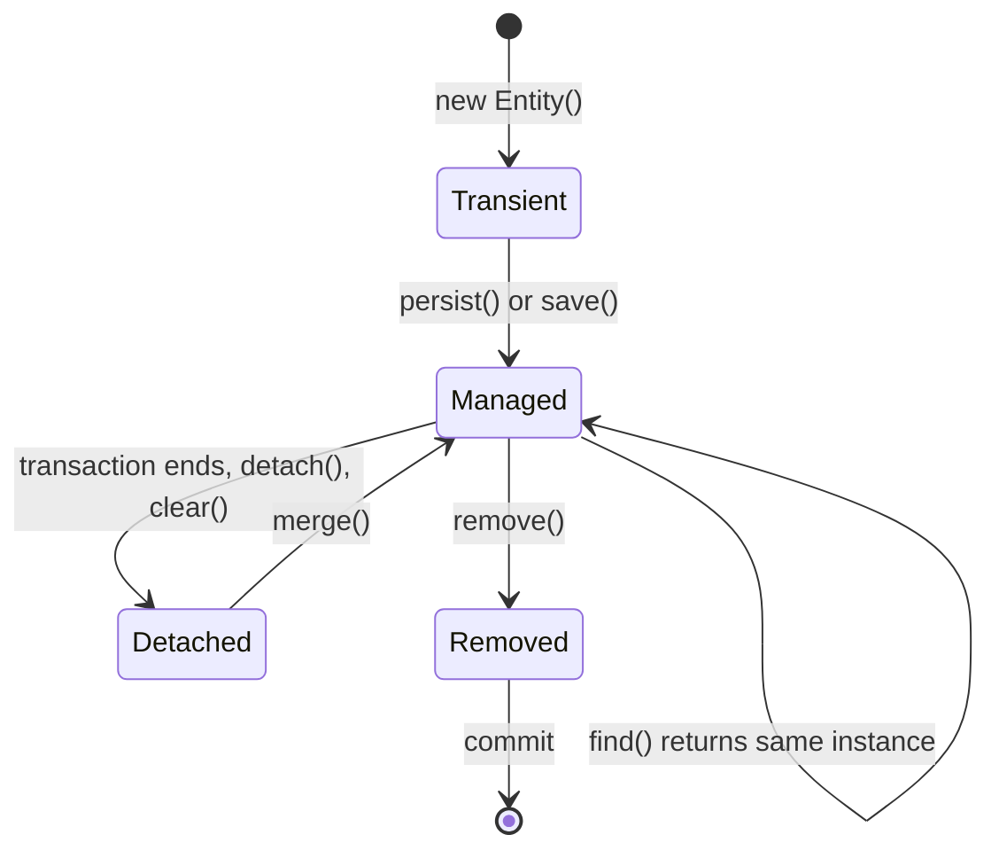
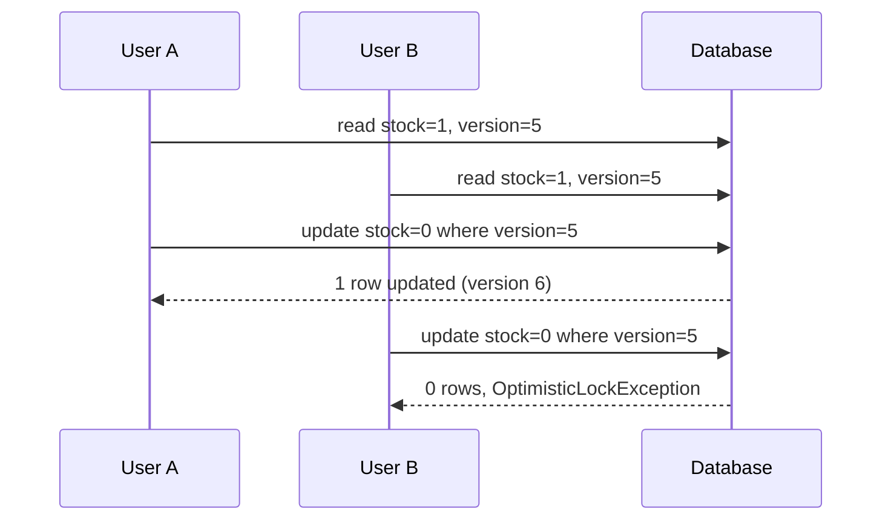
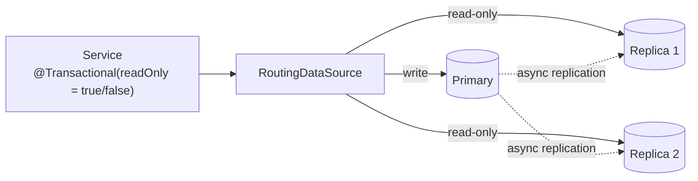

## Beginner

### Q: What is the difference between JPA, Hibernate and Spring Data JPA? {theory}
- **JPA (Jakarta Persistence)** is a **specification**: annotations (`@Entity`, `@Id`) and the `EntityManager` API. It is only interfaces.
- **Hibernate** is the most common **implementation** of JPA (plus extra features of its own).
- **Spring Data JPA** is a Spring layer on top that **generates repository implementations** from interfaces, so you rarely write `EntityManager` code or boilerplate DAOs.
- **Spring ORM** is the older Spring module with helper classes (`LocalContainerEntityManagerFactoryBean`, `JpaTransactionManager`) that integrate JPA/Hibernate with Spring transactions.



### Q: What is the difference between CrudRepository, JpaRepository and PagingAndSortingRepository? How do derived queries work? {coding}
- `CrudRepository`: basic create/read/update/delete.
- `PagingAndSortingRepository`: adds `findAll(Pageable)` and `findAll(Sort)`.
- `JpaRepository`: extends both and adds JPA-specific methods (`flush`, `saveAllAndFlush`, `deleteAllInBatch`, `getReferenceById`).

Spring Data parses **method names** into queries, or you write them with `@Query`.

```java
public interface BookRepository extends JpaRepository<Book, Long> {

    List<Book> findByAuthorAndYearGreaterThan(String author, int year);   // derived query

    @Query("select b from Book b where lower(b.title) like lower(concat('%', :q, '%'))")
    Page<Book> search(@Param("q") String q, Pageable pageable);          // JPQL

    @Query(value = "select * from books where isbn = :isbn", nativeQuery = true)
    Optional<Book> findByIsbnNative(@Param("isbn") String isbn);          // native SQL

    @Modifying
    @Query("update Book b set b.stock = b.stock - :n where b.id = :id and b.stock >= :n")
    int decrementStock(@Param("id") Long id, @Param("n") int n);          // returns rows changed
}
```

### Q: Map a one-to-many relationship between Author and Book correctly. {coding}
Own the relationship on the **many side** (the table with the foreign key) and keep both sides in sync.

```java
@Entity
public class Author {
    @Id @GeneratedValue(strategy = GenerationType.IDENTITY)
    private Long id;
    private String name;

    @OneToMany(mappedBy = "author", cascade = CascadeType.ALL, orphanRemoval = true)
    private List<Book> books = new ArrayList<>();

    public void addBook(Book b) { books.add(b); b.setAuthor(this); }      // keep both sides consistent
    public void removeBook(Book b) { books.remove(b); b.setAuthor(null); }
}

@Entity
public class Book {
    @Id @GeneratedValue(strategy = GenerationType.IDENTITY)
    private Long id;
    private String title;

    @ManyToOne(fetch = FetchType.LAZY)             // default for ToOne is EAGER, so set LAZY
    @JoinColumn(name = "author_id")
    private Author author;
}
```

`mappedBy` marks the inverse side, so no extra join table is created. Prefer `LAZY` everywhere and fetch what you need per query. Override `equals`/`hashCode` carefully (use a business key or the id with a constant `hashCode`), never include lazy collections in `toString`, and do not expose entities directly in REST responses (use DTOs).

## Intermediate

### Q: What is the difference between LAZY and EAGER fetching? What causes LazyInitializationException? {theory}
- `LAZY`: related data is loaded on first access, through a proxy or lazy collection.
- `EAGER`: loaded immediately with the owner, often through extra joins or queries you cannot turn off per use case.

Defaults: `@OneToMany` and `@ManyToMany` are LAZY; `@ManyToOne` and `@OneToOne` are EAGER. Prefer LAZY and fetch explicitly.

`LazyInitializationException` happens when you touch an uninitialized lazy association **after the persistence context (session) has closed**, typically when the entity is serialized in the controller. Fixes: load the data you need inside the transaction using a fetch join or `@EntityGraph`; map to a **DTO inside the service**; or use projections. Avoid "fixing" it with `spring.jpa.open-in-view=true` (the Boot default), which keeps a connection open for the whole HTTP request and hides inefficient queries. Many teams set it to `false`.

### Q: What is the N+1 select problem and how do you fix it? {coding}
Loading N parents with one query, then triggering one extra query **per parent** to load a lazy child, gives 1 + N queries.

```java
List<Author> authors = authorRepo.findAll();                  // 1 query
authors.forEach(a -> System.out.println(a.getBooks().size()));  // N more queries (one per author)
```



Fixes:

```java
public interface AuthorRepository extends JpaRepository<Author, Long> {

    @Query("select distinct a from Author a join fetch a.books")          // 1. fetch join
    List<Author> findAllWithBooks();

    @EntityGraph(attributePaths = "books")                                 // 2. entity graph
    List<Author> findByNameContaining(String name);
}
```

3. `@BatchSize(size = 50)` or `hibernate.default_batch_fetch_size=50` loads children in batches (`where author_id in (...)`), which works well with pagination.
4. A **DTO projection** selecting only needed columns.

Caveat: a fetch join on a collection **breaks database pagination** (Hibernate paginates in memory and warns `HHH90003004`). For paged lists, fetch the page of parents first, then load children with batch fetching or a second query. Detect N+1 in development with `hibernate.generate_statistics` or a query counter in tests.

### Q: Explain the persistence context and entity states. What is dirty checking and flush? {theory}
The **persistence context** (first-level cache) is a per-transaction map of managed entities. Entities move between states:



- **Managed:** tracked; changes are detected automatically.
- **Dirty checking:** at flush, Hibernate compares each managed entity with its loaded snapshot and issues `UPDATE` for changes, so you do **not** need to call `save()` inside a transaction after modifying a managed entity.
- **Flush:** synchronizes memory with the database (before commit, before a query that may be affected under `FlushMode.AUTO`, or manually). Flush is not commit.
- The first-level cache means `findById` twice in one transaction returns the same object with one query.

### Q: Explain @Transactional propagation, isolation and rollback rules. {theory}
**Propagation** decides what happens when a transactional method calls another:

| Propagation | Behavior |
|---|---|
| `REQUIRED` (default) | Join the existing transaction, or start one |
| `REQUIRES_NEW` | Suspend the current one and start a new independent transaction |
| `NESTED` | A savepoint inside the current transaction (JDBC; not supported by JPA providers in all setups) |
| `SUPPORTS` / `NOT_SUPPORTED` | Run in a transaction if one exists / always run without one |
| `MANDATORY` / `NEVER` | Must have one / must not have one, otherwise an exception |

**Isolation** controls visibility between concurrent transactions: `READ_COMMITTED` (common default), `REPEATABLE_READ`, `SERIALIZABLE`. Higher levels prevent more anomalies (non-repeatable reads, phantoms) at the cost of concurrency; the exact behavior is database-specific.

**Rollback rules:** only unchecked exceptions and errors roll back by default; use `rollbackFor` for checked ones. A `REQUIRES_NEW` method must be called **through another bean** (proxy), otherwise it silently joins the caller's transaction. Use `readOnly = true` for queries to skip dirty checking and allow driver optimizations.

```java
@Service
class OrderService {
    @Transactional
    public void placeOrder(Order o) {
        orderRepo.save(o);
        auditService.log(o);          // auditService.log is REQUIRES_NEW: audit survives a rollback of the order
    }
}
```

## Experienced

### Q: Two users buy the last item at the same time. How do you prevent overselling? {scenario}
This is a lost-update race: both read `stock = 1`, both write `0`, and you sell two items.

Options, from lightest to strongest:

1. **Optimistic locking** with `@Version`: the update includes `where version = ?`; the loser gets `OptimisticLockingFailureException` and retries or reports a conflict. Best when conflicts are rare.
2. **Atomic conditional update**: let the database enforce the rule in one statement (no read-modify-write).
3. **Pessimistic locking**: `SELECT ... FOR UPDATE` blocks others. Use for high-contention rows, but keep the transaction short to avoid deadlocks and pool exhaustion.

```java
@Entity
class Product {
    @Id Long id;
    int stock;
    @Version long version;          // optimistic lock
}

// 2. atomic: returns 0 if there was not enough stock
@Modifying
@Query("update Product p set p.stock = p.stock - :qty where p.id = :id and p.stock >= :qty")
int reserve(@Param("id") Long id, @Param("qty") int qty);

// 3. pessimistic
@Lock(LockModeType.PESSIMISTIC_WRITE)
@Query("select p from Product p where p.id = :id")
Optional<Product> findForUpdate(@Param("id") Long id);
```



For a flash sale prefer the atomic update (or Redis `DECR`) combined with idempotent order creation.

### Q: You must insert 1 million rows. saveAll() is very slow. Why, and how do you speed it up? {scenario}
Reasons: one round trip per row; with `GenerationType.IDENTITY` Hibernate **must insert each row immediately** to obtain the id, which disables JDBC batching; and a huge persistence context keeps every entity in memory and slows dirty checking.

Fixes:

```properties
spring.jpa.properties.hibernate.jdbc.batch_size=500
spring.jpa.properties.hibernate.order_inserts=true
spring.jpa.properties.hibernate.order_updates=true
# MySQL: also add rewriteBatchedStatements=true to the JDBC URL
# PostgreSQL: reWriteBatchedInserts=true
```

```java
@Transactional
public void importAll(Iterator<Row> rows) {
    int i = 0;
    while (rows.hasNext()) {
        em.persist(toEntity(rows.next()));
        if (++i % 500 == 0) { em.flush(); em.clear(); }   // push the batch, free memory
    }
}
```

- Use a **sequence** generator (`GenerationType.SEQUENCE` with `allocationSize` 50) instead of `IDENTITY` so batching works.
- For truly bulk loads skip the ORM: `JdbcTemplate.batchUpdate`, or database tools such as PostgreSQL `COPY` / MySQL `LOAD DATA`.
- Process in chunks with separate short transactions (Spring Batch gives chunking, restart and skip logic).

### Q: How do you size and tune HikariCP, and what happens when the pool is exhausted? {theory}
The pool limits concurrent database connections. A connection is held from the start of a transaction (or first query) until it ends. When all are in use, threads wait up to `connectionTimeout` (default 30 s) and then fail with `SQLTransientConnectionException: ... Connection is not available`.

Sizing: bigger is not better. A good starting point is `pool size ≈ (core_count * 2) + effective_spindle_count`, often **10 to 20** per instance, then measure. Remember `instances x pool size` must stay below the database `max_connections`.

```properties
spring.datasource.hikari.maximum-pool-size=15
spring.datasource.hikari.minimum-idle=15
spring.datasource.hikari.connection-timeout=5000
spring.datasource.hikari.max-lifetime=1740000     # below the DB or proxy idle timeout
spring.datasource.hikari.leak-detection-threshold=20000
```

Common root causes of exhaustion: long transactions that call slow external APIs while holding a connection; N+1 queries; `open-in-view` keeping connections for the whole request; missing timeouts. Fix the cause (shorter transactions, no remote calls inside `@Transactional`) before raising the pool size. Watch `hikaricp.connections.active` and `hikaricp.connections.pending` metrics.

### Q: Design read/write splitting across a primary and read replicas in Spring. {design}
Route writes to the primary and read-only transactions to replicas using `AbstractRoutingDataSource`, keyed by the transaction's read-only flag.



```java
class RoutingDataSource extends AbstractRoutingDataSource {
    @Override
    protected Object determineCurrentLookupKey() {
        return TransactionSynchronizationManager.isCurrentTransactionReadOnly() ? "replica" : "primary";
    }
}

@Bean
DataSource dataSource(DataSource primary, DataSource replica) {
    RoutingDataSource ds = new RoutingDataSource();
    ds.setTargetDataSources(Map.of("primary", primary, "replica", replica));
    ds.setDefaultTargetDataSource(primary);
    // wrap in LazyConnectionDataSourceProxy so the route is chosen after the transaction flags are set
    return new LazyConnectionDataSourceProxy(ds);
}
```

Trade-offs to discuss: **replication lag** means a user may not see their own write, so read from the primary right after a write (read-your-writes) or for sensitive flows; keep connection pools separate per target; fail over gracefully if a replica is down; and monitor lag. Managed options (Aurora reader endpoints, proxy layers) can remove this code.
