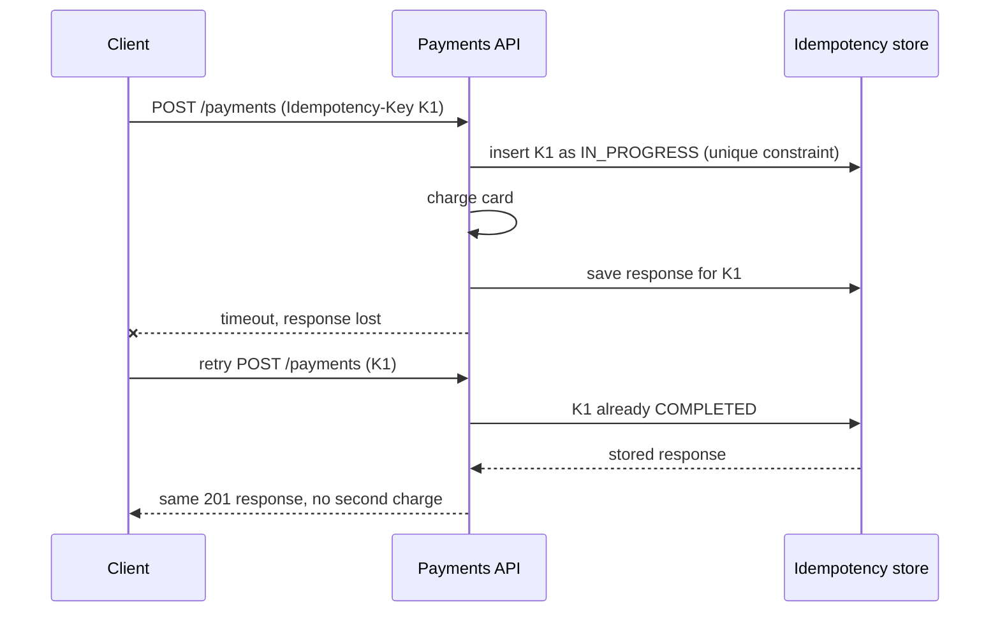
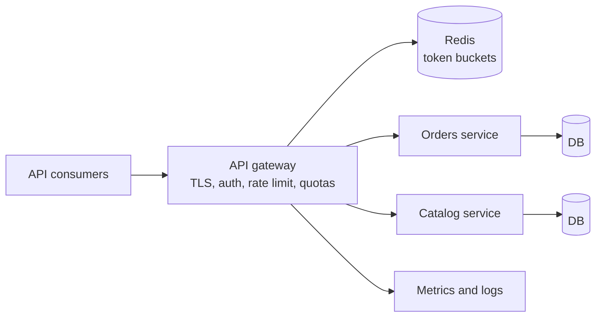

## Beginner

### Q: What are the REST principles and which HTTP methods are safe and idempotent? {theory}
REST is an architectural style over HTTP. Core constraints: **client-server**, **stateless** (each request carries everything needed), **cacheable**, a **uniform interface** (resources identified by URIs, manipulated through representations, standard methods), and a layered system.

| Method | Purpose | Safe | Idempotent |
|---|---|---|---|
| `GET` | Read | Yes | Yes |
| `POST` | Create / non-idempotent action | No | **No** |
| `PUT` | Replace a resource | No | Yes |
| `PATCH` | Partial update | No | Not guaranteed |
| `DELETE` | Remove | No | Yes |

*Safe* means no state change. *Idempotent* means repeating the call has the same effect as making it once (the second `DELETE` may return `404`, but the state is the same). Idempotency is what makes retries safe.

Design tips: use **nouns, plural, lowercase** (`/orders/42/items`), not verbs (`/getOrder`); keep URLs shallow; use query parameters for filtering.

### Q: Which HTTP status codes should an API return, and when? {theory}
- **200 OK**: success with a body. **201 Created**: resource created, with a `Location` header. **204 No Content**: success with no body (delete, some updates).
- **400 Bad Request**: malformed or invalid input. **401 Unauthorized**: not authenticated (missing or bad credentials). **403 Forbidden**: authenticated but not allowed. **404 Not Found**. **405 Method Not Allowed**. **409 Conflict**: state conflict, duplicate, optimistic-lock failure. **415 Unsupported Media Type**. **422 Unprocessable Entity**: semantic validation errors (some teams use 400). **429 Too Many Requests**.
- **500 Internal Server Error**: your bug. **502 / 503 / 504**: bad gateway, unavailable, timeout from upstream.

Common mistake: returning `200` with `{"error": ...}`. Clients, caches and monitoring rely on the status code.

### Q: Build a CRUD REST controller for a Book resource with correct status codes. {coding}
```java
@RestController
@RequestMapping("/api/v1/books")
class BookController {
    private final BookService service;
    BookController(BookService service) { this.service = service; }

    @GetMapping("/{id}")
    BookDto get(@PathVariable Long id) { return service.get(id); }          // 200, or 404 via exception

    @PostMapping
    ResponseEntity<BookDto> create(@Valid @RequestBody CreateBookRequest req) {
        BookDto created = service.create(req);
        URI location = ServletUriComponentsBuilder.fromCurrentRequest()
                .path("/{id}").buildAndExpand(created.id()).toUri();
        return ResponseEntity.created(location).body(created);              // 201 + Location header
    }

    @PutMapping("/{id}")
    BookDto replace(@PathVariable Long id, @Valid @RequestBody UpdateBookRequest req) {
        return service.replace(id, req);                                    // 200
    }

    @DeleteMapping("/{id}")
    @ResponseStatus(HttpStatus.NO_CONTENT)
    void delete(@PathVariable Long id) { service.delete(id); }              // 204
}
```

Controllers should be thin: translate HTTP to a service call and back; keep business rules and transactions in the service layer and use DTOs (records) at the boundary, not JPA entities.

## Intermediate

### Q: What are the strategies for API versioning, and which would you choose? {theory}
| Strategy | Example | Notes |
|---|---|---|
| URI path | `/api/v1/books` | Most common, visible, easy to route and cache |
| Header | `X-API-Version: 2` | Clean URLs, harder to test in a browser |
| Media type | `Accept: application/vnd.shop.v2+json` | Most "RESTful", most complex |
| Query param | `/books?version=2` | Simple, but clutters caches and URLs |

A pragmatic default is **URI versioning**. More important than the mechanism is **avoiding breaking changes**: only add optional fields, never remove or rename, keep old behavior until clients migrate, publish a deprecation policy (`Deprecation` and `Sunset` headers), and run old and new versions side by side. Newer Spring versions (Framework 7 / Boot 4) add built-in API versioning support; on Spring 6 you map the version in the path or write a custom `RequestCondition`. Check the reference for your version.

### Q: How do you design pagination, filtering and sorting? Offset vs cursor pagination? {coding}
```java
@GetMapping
Page<BookDto> list(@RequestParam(required = false) String author,
                   @PageableDefault(size = 20, sort = "title") Pageable pageable) {
    return service.search(author, pageable);        // ?author=x&page=2&size=20&sort=year,desc
}
```

| | Offset (`page`, `size`) | Cursor / keyset (`after=<last id>`) |
|---|---|---|
| Simplicity | Easy, jump to any page | Slightly harder, next/previous only |
| Large data | `OFFSET 1000000` gets slow | Constant speed: `where id > :last order by id limit 20` |
| Consistency | Rows shift when data changes (duplicates, skips) | Stable while data changes |

Use offset for small admin tables and cursor/keyset for large, fast-changing feeds. Always **cap `size`** (for example 100) so clients cannot request millions of rows, and return metadata (total, next cursor, links). Spring Data 3.1+ offers `ScrollPosition` for keyset scrolling.

### Q: What error format should a REST API return? {coding}
Use a consistent machine-readable error body. Spring 6 supports **RFC 7807 Problem Details** natively; enable it for built-in MVC exceptions with `spring.mvc.problemdetails.enabled=true`.

```json
{
  "type": "https://api.shop.com/errors/out-of-stock",
  "title": "Out of stock",
  "status": 409,
  "detail": "Product 42 has only 1 unit left",
  "instance": "/api/v1/orders",
  "traceId": "4bf92f3577b34da6a3ce929d0e0e4736"
}
```

```java
@RestControllerAdvice
class ApiErrors extends ResponseEntityExceptionHandler {   // handles standard MVC exceptions as ProblemDetail
    @ExceptionHandler(OutOfStockException.class)
    ProblemDetail onOutOfStock(OutOfStockException ex) {
        ProblemDetail pd = ProblemDetail.forStatusAndDetail(HttpStatus.CONFLICT, ex.getMessage());
        pd.setTitle("Out of stock");
        pd.setType(URI.create("https://api.shop.com/errors/out-of-stock"));
        return pd;
    }
}
```

Include a stable error `type` or code that clients can switch on, a correlation/trace id for support, and never expose stack traces or SQL.

### Q: How do you support HTTP caching with ETag and conditional requests? {coding}
Let clients and proxies avoid re-downloading unchanged data. The server sends an `ETag` validator; the client replays it with `If-None-Match`, and the server answers `304 Not Modified` with no body.

```java
@GetMapping("/{id}")
ResponseEntity<BookDto> get(@PathVariable Long id) {
    BookDto book = service.get(id);
    return ResponseEntity.ok()
        .eTag("\"" + book.version() + "\"")                        // use the entity @Version
        .cacheControl(CacheControl.maxAge(Duration.ofMinutes(5)).cachePublic())
        .body(book);
}
```

Simpler for whole responses: register `ShallowEtagHeaderFilter`, which hashes the body (saves bandwidth, not server work). Use `If-Match` with the version on `PUT` as an **optimistic concurrency** guard: reject with `412 Precondition Failed` if the resource changed since the client read it.

## Experienced

### Q: A client retries a payment POST after a timeout and the customer is charged twice. How do you make POST safe to retry? {scenario}
`POST` is not idempotent, and a timeout leaves the client unsure whether the server processed the request. Use an **idempotency key**: the client generates a unique key per logical operation and sends it in a header; the server stores the first result and returns the same response for any repeat.



```java
@PostMapping("/payments")
ResponseEntity<PaymentDto> pay(@RequestHeader("Idempotency-Key") String key,
                               @Valid @RequestBody PaymentRequest req) {
    return idempotency.execute(key, req, () -> paymentService.charge(req));
}
// idempotency.execute: insert key row (unique), run once, store result;
// if the key exists: return the stored result, or 409 if still IN_PROGRESS;
// if the same key arrives with a different body: reject with 422.
```

Details that matter: a **unique database constraint** on the key to win the race between concurrent duplicates, a key expiry (24 to 48 hours), storing a hash of the request to detect misuse, and idempotent downstream calls (pass the key to the payment provider too).

### Q: Design a public REST API with rate limiting and quotas for thousands of API consumers. {design}


- **Enforce at the edge**: API gateway (Spring Cloud Gateway, Kong, AWS API Gateway) so abusive traffic never reaches services.
- **Algorithm**: token bucket per API key (smooth bursts, steady refill) stored in **Redis** so limits are shared across gateway instances. Spring Cloud Gateway has a `RequestRateLimiter` filter backed by Redis.
- **Contract**: return `429 Too Many Requests` with `Retry-After`, and expose `X-RateLimit-Limit`, `-Remaining`, `-Reset` headers.
- **Tiers**: different limits per plan; separate short-term rate limits from monthly quotas.
- **Protect services too**: timeouts, bulkheads, load shedding, and idempotency for retried writes.
- **Operability**: per-consumer metrics, API keys with rotation, OpenAPI documentation (springdoc), versioning and deprecation policy.

### Q: How should a Spring service call other REST APIs: RestTemplate, RestClient, WebClient or declarative HTTP interfaces? {coding}
- `RestTemplate`: the legacy blocking client, in maintenance mode.
- **`RestClient`** (Spring 6.1): the modern **blocking** fluent client; use it in MVC apps.
- `WebClient`: reactive and non-blocking; use it in WebFlux apps (or when you need streaming).
- **HTTP interface clients** (Spring 6): declare an interface, Spring generates the implementation on top of `RestClient`/`WebClient`.

```java
@HttpExchange("/prices")
interface PriceClient {
    @GetExchange("/{sku}")
    Price get(@PathVariable String sku);
}

@Configuration
class ClientConfig {
    @Bean
    PriceClient priceClient(RestClient.Builder builder) {
        RestClient rc = builder.baseUrl("https://pricing.internal")
            .requestFactory(new JdkClientHttpRequestFactory(
                HttpClient.newBuilder().connectTimeout(Duration.ofSeconds(1)).build()))
            .build();
        return HttpServiceProxyFactory.builderFor(RestClientAdapter.create(rc)).build()
                                      .createClient(PriceClient.class);
    }
}
```

Whatever you choose: set **connect and read timeouts**, reuse a pooled client, propagate trace headers, and wrap calls with a retry and circuit breaker.
