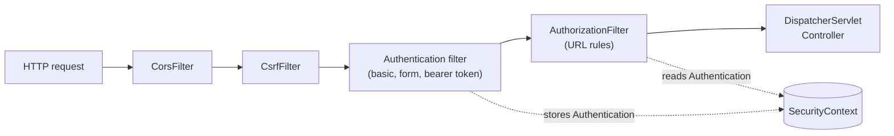
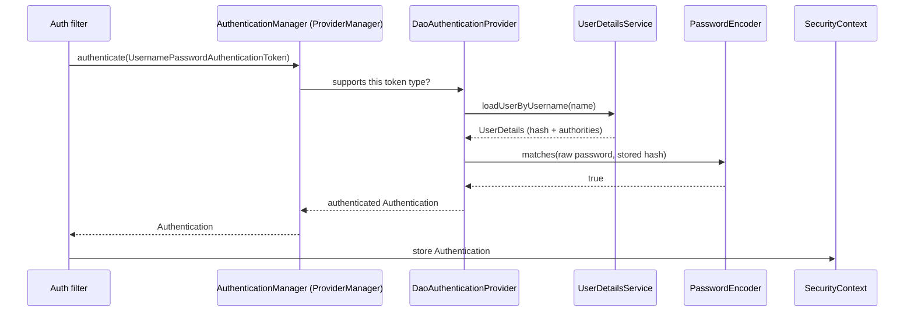
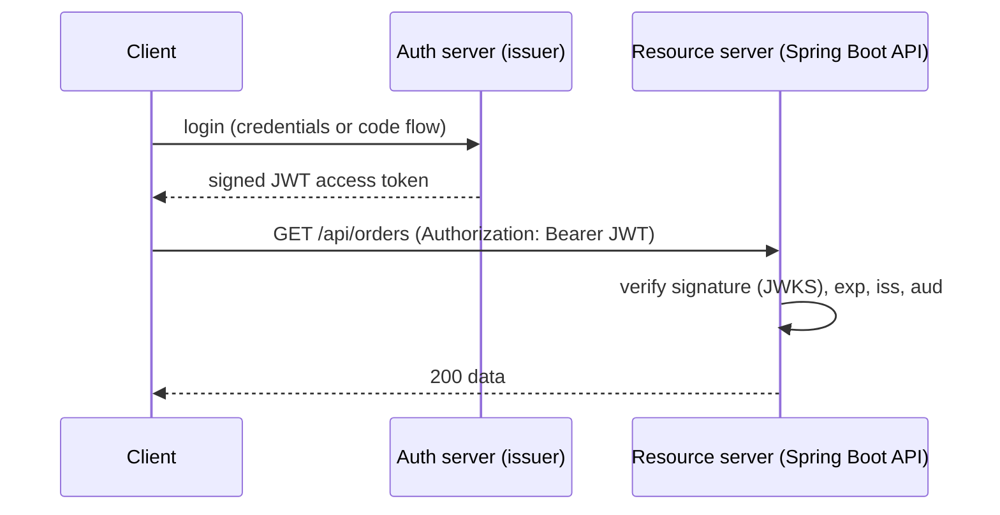
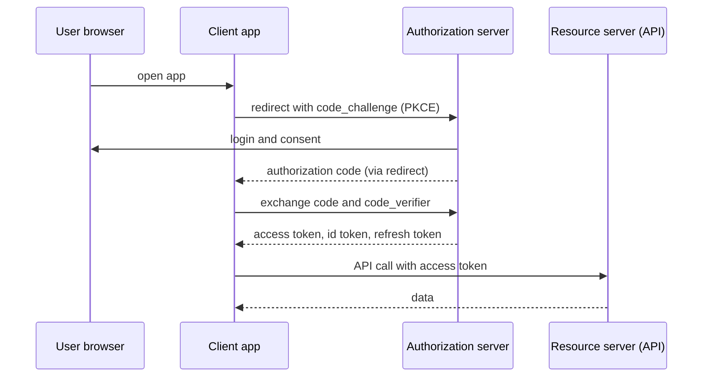
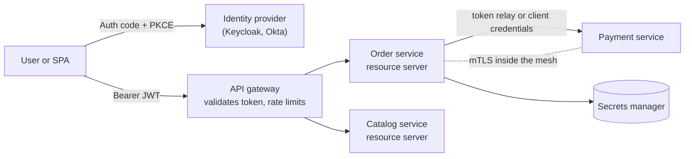
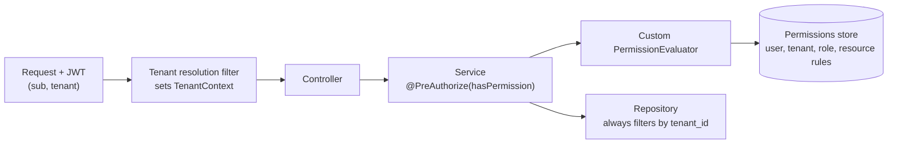

## Beginner

### Q: What is the difference between authentication and authorization, and how does Spring Security fit into a request? {theory}
- **Authentication:** proving *who you are* (username/password, token, certificate).
- **Authorization:** deciding *what you may do* (roles, authorities, permissions).

Spring Security is built on a **chain of servlet filters** that sits in front of `DispatcherServlet`. Each filter has one job (CORS, CSRF, authentication, session handling, authorization). Requests that fail are rejected before reaching your controller.



The result of authentication is an `Authentication` object (principal, credentials, authorities) held in the `SecurityContext`, available through `SecurityContextHolder` for the current request.

### Q: How do you configure Spring Security in Spring Boot 3 (no WebSecurityConfigurerAdapter)? {coding}
`WebSecurityConfigurerAdapter` was removed in Spring Security 6. Declare a `SecurityFilterChain` bean using the lambda DSL.

```java
@Configuration
@EnableWebSecurity
class SecurityConfig {

    @Bean
    SecurityFilterChain api(HttpSecurity http) throws Exception {
        http
            .csrf(csrf -> csrf.disable())                         // stateless token API; see the CSRF question
            .sessionManagement(s -> s.sessionCreationPolicy(SessionCreationPolicy.STATELESS))
            .authorizeHttpRequests(auth -> auth
                .requestMatchers("/actuator/health", "/api/public/**").permitAll()
                .requestMatchers(HttpMethod.DELETE, "/api/**").hasRole("ADMIN")
                .requestMatchers("/api/**").authenticated()
                .anyRequest().denyAll())                          // deny by default
            .httpBasic(Customizer.withDefaults());
        return http.build();
    }

    @Bean
    PasswordEncoder passwordEncoder() { return PasswordEncoderFactories.createDelegatingPasswordEncoder(); }
}
```

Rules are evaluated **top to bottom, first match wins**, so put specific rules before general ones. End with `anyRequest().denyAll()` or `authenticated()` so nothing is accidentally open.

### Q: How should passwords be stored? {theory}
Never store plain text or fast hashes (MD5, SHA-1, plain SHA-256). Store a **salted, deliberately slow, adaptive hash**: `BCryptPasswordEncoder`, Argon2 (`Argon2PasswordEncoder`), SCrypt or PBKDF2. The salt is generated per password and stored inside the hash string, so identical passwords hash differently.

`DelegatingPasswordEncoder` (the default from `PasswordEncoderFactories.createDelegatingPasswordEncoder()`) stores the algorithm as a prefix like `{bcrypt}$2a$10$...`, which lets you **upgrade algorithms over time**: old hashes still verify, and you re-encode on the next successful login (`UserDetailsPasswordService`). Hashing is one-way: you can compare but never recover a password, and password reset must issue a new one.

## Intermediate

### Q: Explain the authentication flow with UserDetailsService, AuthenticationManager and AuthenticationProvider. {theory}


- The filter builds an unauthenticated token and hands it to the `AuthenticationManager`.
- `ProviderManager` asks each `AuthenticationProvider` whether it supports the token.
- `DaoAuthenticationProvider` loads the user through your `UserDetailsService` and verifies the password with the `PasswordEncoder`.

```java
@Service
class DbUserDetailsService implements UserDetailsService {
    private final UserRepository users;
    DbUserDetailsService(UserRepository users) { this.users = users; }

    @Override
    public UserDetails loadUserByUsername(String username) {
        return users.findByEmail(username)
            .map(u -> User.withUsername(u.getEmail())
                          .password(u.getPasswordHash())
                          .roles(u.getRoles().toArray(String[]::new))
                          .disabled(!u.isActive())
                          .build())
            .orElseThrow(() -> new UsernameNotFoundException("not found"));
    }
}
```

Expose a `UserDetailsService` bean and Spring Boot wires the provider for you. Return a generic "bad credentials" message so attackers cannot tell whether the username exists.

### Q: How does method-level security work (@PreAuthorize)? Role vs authority? {coding}
Enable it with `@EnableMethodSecurity` (Spring Security 6; replaces `@EnableGlobalMethodSecurity`). It is applied with AOP proxies, so the self-invocation limitations apply.

```java
@Configuration
@EnableMethodSecurity
class MethodSecurityConfig {}

@Service
class DocumentService {

    @PreAuthorize("hasRole('ADMIN') or #ownerId == authentication.principal.id")
    public List<Document> byOwner(Long ownerId) { ... }

    @PreAuthorize("hasAuthority('DOC_DELETE')")
    public void delete(Long id) { ... }

    @PostAuthorize("returnObject.ownerId == authentication.principal.id")
    public Document get(Long id) { ... }            // checks after loading
}
```

An **authority** is a fine-grained permission string (`DOC_DELETE`). A **role** is an authority with the `ROLE_` prefix (`hasRole('ADMIN')` checks `ROLE_ADMIN`). Prefer permissions for logic and roles to group them. Use method security for **business-level** rules (ownership checks) and URL rules for coarse access; apply both (defense in depth).

### Q: What is CSRF, when do you need protection, and how is it different from CORS? {theory}
**CSRF** (cross-site request forgery): a malicious site makes the victim's browser send a state-changing request to your site, and the browser attaches the victim's **session cookie** automatically. Spring Security defends by requiring a secret token (`_csrf`) on `POST/PUT/PATCH/DELETE` that a forged request cannot know.

- **Needed** for apps that authenticate with **cookies/sessions** (server-rendered apps, cookie-based SPAs). Keep it enabled.
- **Not needed** for stateless APIs where the client sends credentials explicitly in an `Authorization: Bearer` header, because the browser does not add that automatically. Disabling CSRF is fine in that case, but not for cookie auth.

**CORS** is different: it is a browser mechanism that relaxes the same-origin policy for reads/responses from another origin. CORS does not stop CSRF (the request is still sent). Enable CORS in the security chain (`http.cors(...)`) so preflight requests are not blocked.

### Q: Implement stateless JWT authentication. What are the pitfalls? {coding}
The simplest correct approach with Spring Security 6 is to make the API an **OAuth2 resource server** that validates JWTs, rather than writing a custom filter.

```java
@Bean
SecurityFilterChain api(HttpSecurity http) throws Exception {
    http.csrf(c -> c.disable())
        .sessionManagement(s -> s.sessionCreationPolicy(SessionCreationPolicy.STATELESS))
        .authorizeHttpRequests(a -> a.requestMatchers("/api/**").authenticated())
        .oauth2ResourceServer(o -> o.jwt(Customizer.withDefaults()));   // validates signature, exp, iss
    return http.build();
}
// application.yml
// spring.security.oauth2.resourceserver.jwt.issuer-uri: https://login.example.com/realms/shop
// (public keys are fetched from the issuer's JWKS endpoint and cached)
```



Pitfalls: JWTs **cannot be revoked** before expiry, so keep access tokens short (5 to 15 minutes) with refresh tokens; never put secrets or sensitive data in the payload (it is only encoded, not encrypted); always validate signature, expiry, issuer and audience; prefer asymmetric keys (RS256/ES256); reject the `none` algorithm; and store tokens carefully in browsers (avoid `localStorage` for high-value apps; prefer `HttpOnly` cookies with CSRF protection or a backend-for-frontend).

## Experienced

### Q: Explain OAuth 2.0 and OpenID Connect. Which flow should a single-page app and a backend service use? {theory}
**OAuth 2.0** is about **delegated authorization**: a client gets an access token to call an API on behalf of a user. **OpenID Connect (OIDC)** adds an identity layer on top: an `id_token` (a JWT about the user) and a `userinfo` endpoint, so it also handles **login**.

Roles: resource owner (user), client (your app), authorization server (Keycloak, Okta, Auth0, Spring Authorization Server), resource server (the API).

- **Browser/mobile apps:** **Authorization Code flow with PKCE**. Never use the implicit flow or the password grant (both deprecated).
- **Service to service (no user):** **Client Credentials** flow.
- Refresh tokens renew access without asking the user again.



In Spring: `spring-boot-starter-oauth2-client` for login/clients (`oauth2Login()`), `spring-boot-starter-oauth2-resource-server` for APIs, and **Spring Authorization Server** if you must build your own issuer.

### Q: How do you secure a microservices architecture end to end? {design}


- **Central identity provider** issues tokens; do not build login in every service.
- **Gateway** authenticates at the edge, applies coarse rules and rate limits; **every service still validates the JWT itself** (zero trust: never trust "internal" traffic).
- **Propagate identity** to downstream calls by relaying the user's token (Spring Cloud Gateway `TokenRelay`, `WebClient` filter), or use **client credentials** with narrow scopes when the call is not on behalf of a user.
- **Encrypt in transit** everywhere, using mTLS in a service mesh (Istio, Linkerd) where available.
- **Least privilege:** scopes and claims-to-authorities mapping per service; keep secrets in Vault or a cloud secrets manager, not in config files.
- **Audit and observe:** log authentication events with a correlation id, alert on anomalies.

### Q: What are the common security vulnerabilities in a Spring web app and how do you mitigate them? {scenario}
- **Injection (SQL/JPQL):** use parameter binding and Spring Data methods; never concatenate user input into queries.
- **Broken access control (IDOR):** `GET /orders/42` must check that order 42 belongs to the caller; enforce with `@PreAuthorize` or ownership predicates in queries.
- **XSS:** escape output (Thymeleaf escapes by default), send a `Content-Security-Policy`; Spring Security adds security headers by default (`X-Content-Type-Options`, `X-Frame-Options`, HSTS on HTTPS).
- **CSRF:** see above; keep it on for cookie auth.
- **Session fixation:** Spring Security changes the session id on login by default; set cookies `HttpOnly`, `Secure`, `SameSite`.
- **Brute force and credential stuffing:** rate limit login, add account lockout or exponential delay, support MFA.
- **Mass assignment:** bind to purpose-built DTOs, never directly to entities.
- **Sensitive data exposure:** lock down Actuator (`management.endpoints.web.exposure.include=health,info`, secure the rest), mask secrets in logs, keep dependencies patched (Dependabot, OWASP dependency check).
- **SSRF / deserialization:** validate outbound URLs; avoid Java native deserialization of untrusted data.

### Q: Design fine-grained, multi-tenant authorization where users have roles per tenant and some rules depend on the resource (ABAC). {design}
Plain roles (`ROLE_ADMIN`) are too coarse when "Alice is ADMIN in tenant A but VIEWER in tenant B" and rules depend on resource attributes.



```java
@Component
class TenantPermissionEvaluator implements PermissionEvaluator {
    private final MembershipRepository memberships;
    TenantPermissionEvaluator(MembershipRepository m) { this.memberships = m; }

    @Override
    public boolean hasPermission(Authentication auth, Object target, Object permission) {
        if (target instanceof Document d) {
            return memberships.roleOf(auth.getName(), d.getTenantId())
                              .map(role -> role.allows(permission.toString()))
                              .orElse(false);
        }
        return false;
    }
    @Override
    public boolean hasPermission(Authentication a, Serializable id, String type, Object permission) { return false; }
}

@PreAuthorize("hasPermission(#doc, 'WRITE')")
public void update(Document doc) { ... }
```

Key design rules: **resolve the tenant once** per request from a trusted source (token claim, not a client header) and apply it everywhere; add `tenant_id` filtering to **every query** (Hibernate `@Filter`, row-level security in PostgreSQL, or schema per tenant) so one missed `where` cannot leak data; keep permissions in data, cached with a short TTL, so rules change without redeploying; and test the negative cases (user A reading tenant B) explicitly. For rules at scale, consider an external policy engine (OPA, Cedar, Spring Authorization's `AuthorizationManager`).
