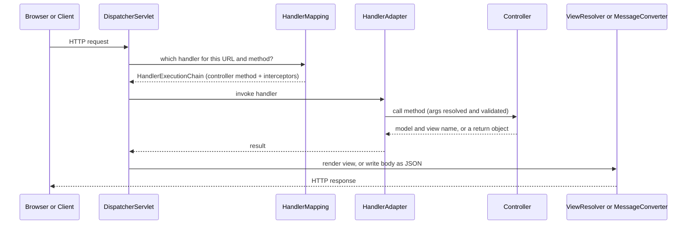
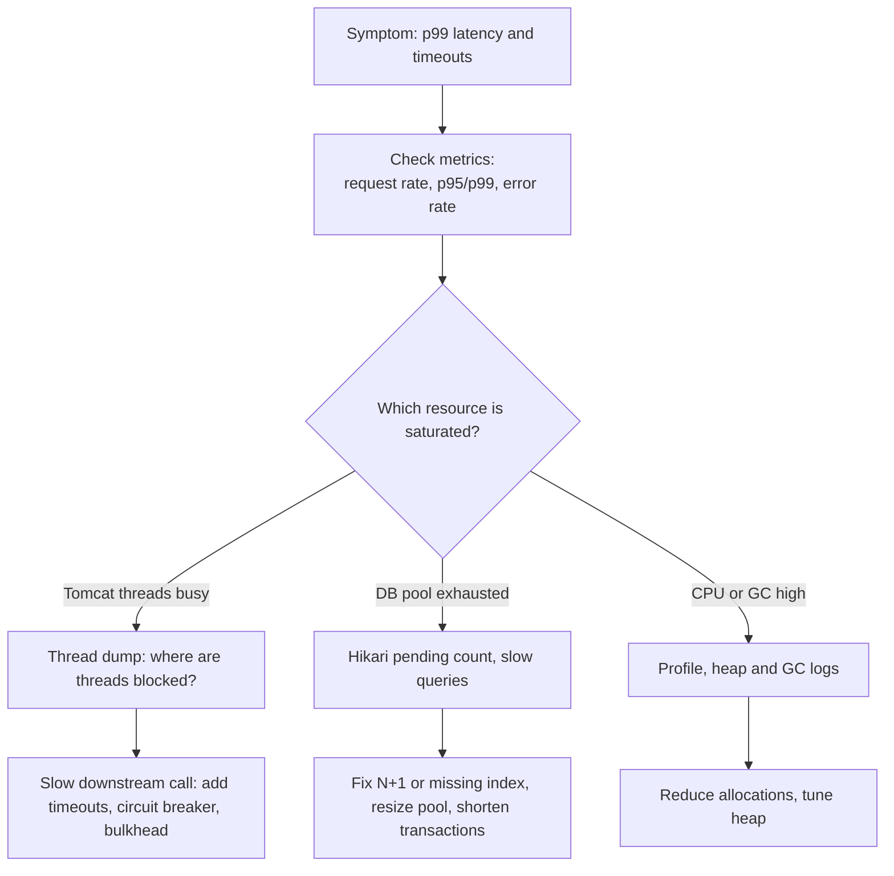
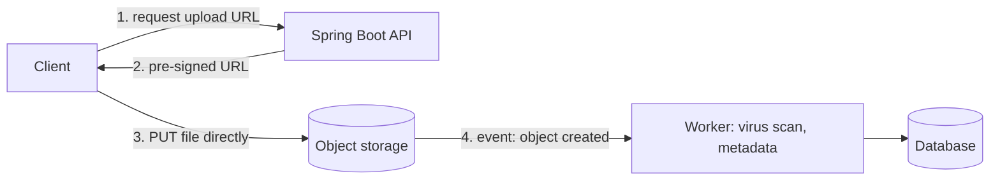

## Beginner

### Q: Explain the Spring MVC request flow. What does DispatcherServlet do? {theory}
`DispatcherServlet` is the **front controller**: every request enters through it, and it coordinates the other components.



Steps: map the request to a handler; run interceptor `preHandle`; resolve arguments (`@PathVariable`, `@RequestBody`...); invoke the method; for `@RestController` an `HttpMessageConverter` (Jackson) writes the return value as JSON, otherwise a `ViewResolver` picks a template; run `postHandle` / `afterCompletion`.

### Q: What is the difference between @Controller and @RestController? {theory}
`@RestController` is `@Controller` plus `@ResponseBody` on every method. With `@Controller`, a returned `String` is treated as a **view name** (for Thymeleaf/JSP); with `@RestController` the return value is serialized into the response body (JSON by default).

```java
@RestController
@RequestMapping("/api/books")
class BookController {
    @GetMapping("/{id}")
    Book get(@PathVariable Long id) { return service.find(id); }   // serialized to JSON
}
```

### Q: Explain @RequestParam, @PathVariable, @RequestBody, @RequestHeader and @ModelAttribute. {theory}
- `@PathVariable`: a value from the URL path, `/users/{id}`.
- `@RequestParam`: a query string or form parameter, `/users?role=admin`. Supports `required` and `defaultValue`.
- `@RequestBody`: the whole request body, deserialized by an `HttpMessageConverter` (JSON to object).
- `@RequestHeader`: an HTTP header value.
- `@ModelAttribute`: binds form fields or query parameters onto an object (also the default for simple object parameters).

```java
@PostMapping("/users/{orgId}/invite")
ResponseEntity<Void> invite(@PathVariable Long orgId,
                            @RequestParam(defaultValue = "member") String role,
                            @RequestHeader("X-Request-Id") String requestId,
                            @RequestBody @Valid InviteRequest body) { ... }
```

## Intermediate

### Q: How do you validate input and handle exceptions globally? {coding}
Add `spring-boot-starter-validation`, annotate the DTO with Bean Validation constraints, and trigger validation with `@Valid` (body) or `@Validated` (path/query parameters on the class). Handle failures in one place with `@RestControllerAdvice`.

```java
public record CreateUserRequest(
    @NotBlank @Size(max = 50) String name,
    @Email @NotBlank String email,
    @Min(18) int age) {}

@RestController
class UserController {
    @PostMapping("/users")
    ResponseEntity<UserDto> create(@Valid @RequestBody CreateUserRequest req) { ... }
}

@RestControllerAdvice
class GlobalExceptionHandler {

    @ExceptionHandler(MethodArgumentNotValidException.class)
    ProblemDetail onInvalid(MethodArgumentNotValidException ex) {
        ProblemDetail pd = ProblemDetail.forStatusAndDetail(HttpStatus.BAD_REQUEST, "Validation failed");
        pd.setProperty("errors", ex.getBindingResult().getFieldErrors().stream()
            .collect(Collectors.toMap(FieldError::getField, FieldError::getDefaultMessage, (a, b) -> a)));
        return pd;
    }

    @ExceptionHandler(UserNotFoundException.class)
    ProblemDetail onNotFound(UserNotFoundException ex) {
        return ProblemDetail.forStatusAndDetail(HttpStatus.NOT_FOUND, ex.getMessage());
    }
}
```

`ProblemDetail` (Spring 6) implements RFC 7807 `application/problem+json`. Do not leak stack traces or internal messages to clients; log them server-side with a correlation id.

### Q: What is the difference between a Servlet Filter, a HandlerInterceptor and AOP? {theory}
| | Filter | HandlerInterceptor | AOP aspect |
|---|---|---|---|
| Belongs to | Servlet container | Spring MVC | Spring AOP (any bean) |
| Runs | Before the `DispatcherServlet` | Around the controller method | Around any bean method |
| Can see | Raw request/response | Request, response and the handler | Method arguments and result |
| Typical use | Security, CORS, request logging, compression | Auth checks, locale, timing, per-request context | Transactions, caching, auditing |

Order on the way in: filters, then `DispatcherServlet`, then interceptors `preHandle`, then the controller (and any aspects on it). Spring Security itself is a chain of filters, which is why it works before MVC.

### Q: How does content negotiation work in Spring MVC? {theory}
Spring picks the response format by matching what the client accepts with what the controller can produce:

- The `Accept` header (`application/json`, `application/xml`) is the standard way. Path-extension and `?format=` strategies are disabled by default.
- `produces` / `consumes` on `@RequestMapping` narrow what a method handles; a mismatch gives `406 Not Acceptable` or `415 Unsupported Media Type`.
- An `HttpMessageConverter` that supports the type and media type does the writing (Jackson for JSON, Jackson XML if on the classpath).

```java
@GetMapping(value = "/report", produces = {MediaType.APPLICATION_JSON_VALUE, "text/csv"})
Report report() { ... }
```

### Q: How do you configure CORS and when does a browser send a preflight request? {coding}
CORS is enforced by the **browser**: a cross-origin call with non-simple methods or headers (e.g. `PUT`, `Authorization`, JSON content type) triggers an `OPTIONS` preflight, and the server must answer with `Access-Control-Allow-*` headers.

```java
@Configuration
class WebConfig implements WebMvcConfigurer {
    @Override
    public void addCorsMappings(CorsRegistry r) {
        r.addMapping("/api/**")
         .allowedOrigins("https://app.example.com")
         .allowedMethods("GET", "POST", "PUT", "DELETE")
         .allowedHeaders("Authorization", "Content-Type")
         .allowCredentials(true)
         .maxAge(3600);
    }
}
```

With Spring Security you must enable CORS in the security chain too (`http.cors(Customizer.withDefaults())`), otherwise the filter rejects the preflight before MVC sees it. Never combine `allowCredentials(true)` with a wildcard origin.

## Experienced

### Q: How does Spring MVC handle concurrency, and how do you handle long-running requests? {theory}
Classic Spring MVC uses a **thread-per-request** model: the servlet container (Tomcat, default 200 worker threads) assigns one thread to a request until the response is written. Blocking I/O keeps that thread busy, so slow downstream calls exhaust the pool and requests queue up.

Options:

- **Async processing:** return `Callable<T>`, `DeferredResult<T>` or `CompletableFuture<T>`. The container thread is released while the work runs elsewhere (`DeferredResult` is completed by another event).
- **Virtual threads (Java 21 + Boot 3.2+):** set `spring.threads.virtual.enabled=true`. Tomcat then runs each request on a virtual thread, so blocking calls no longer tie up scarce platform threads. This keeps simple imperative code with much higher concurrency.
- **Offload long jobs:** accept the request, return `202 Accepted` with a status URL, and process through a queue.

```java
@GetMapping("/report")
Callable<Report> report() {
    return () -> reportService.generate();   // runs on the MVC async executor, container thread is freed
}
```

### Q: Users report that your API randomly times out under load. How do you investigate? {scenario}
Approach: confirm, locate the bottleneck, then fix.



Concrete checks: Actuator and Micrometer metrics (`tomcat.threads.busy`, `hikaricp.connections.pending`, `http.server.requests`); thread dumps (many threads `WAITING` on a socket read or on `HikariPool.getConnection`); slow query logs; tracing to find which hop is slow. Typical fixes: set connect and read **timeouts** on every outbound client, cap pool sizes deliberately, add a circuit breaker, cache hot reads, and consider virtual threads. Load-test after the fix.

### Q: How would you design file upload and download for large files without running out of memory? {design}
Never load the whole file into a `byte[]`. Stream it.

- **Upload:** use `MultipartFile` with limits (`spring.servlet.multipart.max-file-size`) for small files; for large files prefer a **pre-signed URL** so the client uploads straight to object storage (S3), and your service only receives metadata. This removes the file from your servers entirely.
- **Download:** return a `StreamingResponseBody` or `ResponseEntity<Resource>` that streams in chunks, set `Content-Disposition`, and support `Range` requests for resume.
- Scan uploads for malware, validate content type by content (not by extension), and generate your own storage key rather than trusting the client's file name.

```java
@GetMapping("/files/{id}")
ResponseEntity<StreamingResponseBody> download(@PathVariable String id) {
    StreamingResponseBody body = out -> storage.copyTo(id, out);   // streams, constant memory
    return ResponseEntity.ok()
        .header(HttpHeaders.CONTENT_DISPOSITION, "attachment; filename=\"report.pdf\"")
        .contentType(MediaType.APPLICATION_PDF)
        .body(body);
}
```


