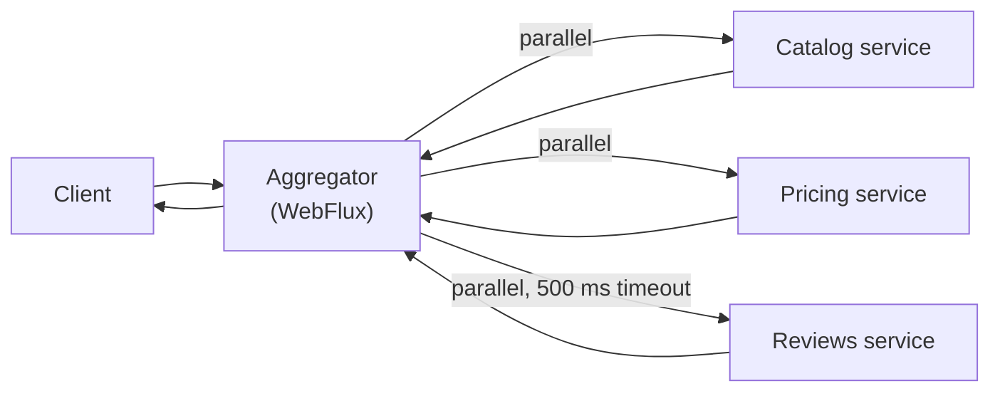
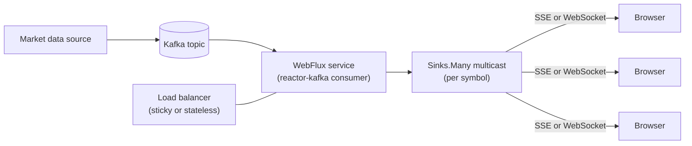

## Beginner

### Q: What is reactive programming and what is Spring WebFlux? {theory}
Reactive programming is a style built around **asynchronous, non-blocking data streams** with **backpressure**. Instead of a thread waiting for a result, you describe a pipeline and the framework runs it as data arrives.

Spring WebFlux is Spring's reactive web stack. It runs on an event-loop server (Netty by default) with a **small, fixed number of threads** that never block, and uses **Project Reactor** types:

- `Mono<T>`: 0 or 1 element (like an async `Optional`).
- `Flux<T>`: 0 to N elements (an async stream).

Nothing happens until someone **subscribes**. In WebFlux the framework subscribes for you when it writes the response.

```java
@GetMapping("/users/{id}")
Mono<User> get(@PathVariable String id) {
    return repo.findById(id);            // returns immediately, a pipeline, not a value
}
```

### Q: What is the difference between Spring MVC and WebFlux, and when would you choose each? {theory}
| | Spring MVC | Spring WebFlux |
|---|---|---|
| Model | Thread per request, blocking | Event loop, non-blocking |
| Server | Tomcat, Jetty, Undertow | Netty (default), also servlet 3.1+ containers |
| Code style | Imperative, easy to debug | Declarative pipelines, harder to debug |
| Data access | JDBC / JPA (blocking) | R2DBC, reactive Mongo/Redis/Cassandra |
| Best for | Most CRUD and business apps | Streaming, very high concurrency with many slow I/O calls, gateways |

Choose WebFlux when you have **end-to-end non-blocking** dependencies and need to hold many concurrent connections cheaply (SSE, websockets, API gateway, aggregators). Choose MVC when your stack is JDBC/JPA or the team is not reactive-experienced. With **virtual threads** (Java 21, Boot 3.2+), MVC now gets much of the scalability benefit with simple blocking code, so the case for WebFlux is narrower than before. WebFlux does not make a single request faster; it lets you serve more concurrent requests per thread.

### Q: What is backpressure? {theory}
Backpressure lets a **slow consumer tell a fast producer how much data it can handle**, so memory does not blow up. In the Reactive Streams specification the subscriber requests `n` items with `request(n)`, and the publisher must not emit more than requested.

```java
Flux.range(1, 1_000_000)
    .onBackpressureBuffer(1000)              // buffer up to 1000, then error (or choose drop/latest)
    .publishOn(Schedulers.boundedElastic())
    .subscribe(new BaseSubscriber<>() {
        @Override protected void hookOnSubscribe(Subscription s) { request(10); }
        @Override protected void hookOnNext(Integer v) { process(v); request(1); }
    });
```

Strategies when a consumer cannot keep up: buffer (bounded), `onBackpressureDrop`, `onBackpressureLatest`, or fail with an error. Over an HTTP connection, TCP flow control and Netty propagate backpressure to the client.

## Intermediate

### Q: What is the difference between map and flatMap in Reactor? {coding}
- `map`: a **synchronous 1-to-1** transformation of each element, `T -> R`.
- `flatMap`: an **asynchronous transformation that returns a publisher**, `T -> Publisher<R>`, and merges the results. Results may arrive out of order and run concurrently.

```java
Mono<UserProfile> profile(String id) {
    return userRepo.findById(id)                                  // Mono<User>
        .map(user -> new UserView(user.name(), user.email()))     // plain function, so map
        .flatMap(view ->                                          // returns Mono, so flatMap
            avatarClient.fetch(view.name())
                        .map(avatar -> new UserProfile(view, avatar)));
}

Flux<Order> ordersOfUsers(Flux<String> userIds) {
    return userIds.flatMap(orderClient::findOrders, 8);           // concurrency of 8, order not preserved
}
```

Use `concatMap` when ordering matters (it processes sequentially). Using `map` with something that returns a `Mono` leaves you with `Mono<Mono<T>>`, a common beginner bug.

### Q: Annotated controllers vs functional endpoints in WebFlux? {coding}
Both run on the same reactive infrastructure. Annotated controllers look like MVC (`@GetMapping`). Functional endpoints define routes as code with `RouterFunction` and `HandlerFunction`, which is explicit and easy to compose.

```java
@Configuration
class UserRoutes {
    @Bean
    RouterFunction<ServerResponse> routes(UserHandler h) {
        return RouterFunctions.route()
            .GET("/users/{id}", h::get)
            .POST("/users", h::create)
            .build();
    }
}

@Component
class UserHandler {
    private final UserRepository repo;
    UserHandler(UserRepository repo) { this.repo = repo; }

    Mono<ServerResponse> get(ServerRequest req) {
        return repo.findById(req.pathVariable("id"))
            .flatMap(u -> ServerResponse.ok().bodyValue(u))
            .switchIfEmpty(ServerResponse.notFound().build());
    }
}
```

Pick annotated style for familiarity and tooling (validation, OpenAPI). Pick functional style for dynamic routing and tiny services.

### Q: What are Schedulers, publishOn and subscribeOn, and what is the number one rule of WebFlux? {theory}
**Rule: never block an event-loop thread.** Netty uses only a few threads (roughly the CPU count), so one blocking call (`Thread.sleep`, JDBC, a blocking HTTP client, `.block()`) stalls many requests.

- `subscribeOn(scheduler)`: sets the thread where the **subscription (source)** runs.
- `publishOn(scheduler)`: switches the thread for **everything downstream** of it.
- `Schedulers.boundedElastic()`: a pool intended for **unavoidable blocking** work (legacy JDBC, file I/O).
- `Schedulers.parallel()`: for CPU-bound, non-blocking work.

```java
Mono<Report> report(String id) {
    return Mono.fromCallable(() -> legacyJdbcDao.load(id))   // blocking call
               .subscribeOn(Schedulers.boundedElastic());     // moved off the event loop
}
```

Use BlockHound in tests to detect accidental blocking calls on non-blocking threads.

## Experienced

### Q: How do you handle errors, retries and timeouts in a reactive pipeline? {coding}
Errors are signals that flow down the pipeline; use operators instead of try/catch.

```java
Mono<Price> price(String sku) {
    return webClient.get().uri("/prices/{sku}", sku)
        .retrieve()
        .onStatus(HttpStatusCode::is4xxClientError,
                  r -> Mono.error(new BadRequestException("bad sku " + sku)))
        .bodyToMono(Price.class)
        .timeout(Duration.ofSeconds(2))                                    // fail if no result in 2s
        .retryWhen(Retry.backoff(3, Duration.ofMillis(200))                // exponential backoff
                        .filter(ex -> ex instanceof WebClientRequestException))   // transient errors only
        .onErrorResume(TimeoutException.class, ex -> Mono.just(Price.unknown(sku))); // fallback
}
```

Key operators: `onErrorReturn` (static fallback), `onErrorResume` (fallback publisher), `onErrorMap` (translate an exception), `retryWhen` (with backoff), `timeout`, `doOnError` (side effect, logging only). For global HTTP error mapping use `@RestControllerAdvice` or a `WebExceptionHandler`. As with MVC, retry only idempotent calls.

### Q: How do you call several downstream services in parallel with WebClient and combine the results? {coding}
`WebClient` is the non-blocking replacement for `RestTemplate`. Independent calls are started together and combined with `Mono.zip`, so total latency is the slowest call instead of the sum.

```java
Mono<ProductPage> productPage(String id) {
    Mono<Product>   product = catalog.get().uri("/products/{id}", id).retrieve().bodyToMono(Product.class);
    Mono<Price>     price   = pricing.get().uri("/prices/{id}", id).retrieve().bodyToMono(Price.class)
                                .onErrorReturn(Price.unavailable());                 // degrade gracefully
    Mono<List<Review>> reviews = reviewsClient.get().uri("/reviews/{id}", id).retrieve()
                                .bodyToFlux(Review.class).collectList()
                                .timeout(Duration.ofMillis(500)).onErrorReturn(List.of());

    return Mono.zip(product, price, reviews)
               .map(t -> new ProductPage(t.getT1(), t.getT2(), t.getT3()));
}
```



Configure `WebClient` with a shared connection pool and explicit connect/response timeouts (Reactor Netty `HttpClient`), and build it once as a bean; do not create a new client per request.

### Q: Can you use JPA/Hibernate with WebFlux? What are the alternatives? {theory}
JPA and JDBC are **blocking**, so calling them directly on an event-loop thread is a bug. Options:

- **R2DBC** (Spring Data R2DBC): reactive relational drivers (PostgreSQL, MySQL, SQL Server, H2). It is a lighter mapper, with no lazy loading, no persistence context and weaker support for complex relationships.
- **Reactive NoSQL**: Spring Data MongoDB Reactive, Redis, Cassandra, Elasticsearch.
- **Wrap blocking code** on `Schedulers.boundedElastic()`. This is acceptable for a few legacy calls, but it defeats the purpose if most of the app is blocking.

Transactions in a reactive app use `TransactionalOperator` or `@Transactional` on methods returning `Mono`/`Flux`, and the transaction context propagates through the Reactor `Context`, not through a `ThreadLocal`. This also means `SecurityContextHolder` and MDC logging behave differently; use `ReactiveSecurityContextHolder` and Reactor context propagation.

### Q: Design a real-time stock-price dashboard that pushes updates to 50,000 browsers. {design}
This is a good fit for WebFlux: many long-lived, mostly idle connections.



```java
@GetMapping(value = "/prices/{symbol}", produces = MediaType.TEXT_EVENT_STREAM_VALUE)
Flux<Price> stream(@PathVariable String symbol) {
    return priceHub.stream(symbol)                      // shared hot Flux from a multicast sink
                   .onBackpressureLatest()              // slow clients only get the newest price
                   .timeout(Duration.ofMinutes(5));
}
```

Design points: **Server-Sent Events** for one-way updates (simple, auto-reconnect) or WebSocket for two-way; one shared upstream subscription per symbol multicast to all subscribers; `onBackpressureLatest` so slow clients never cause unbounded buffers; horizontal scaling with each instance consuming the topic; connection limits and heartbeats to detect dead clients.
