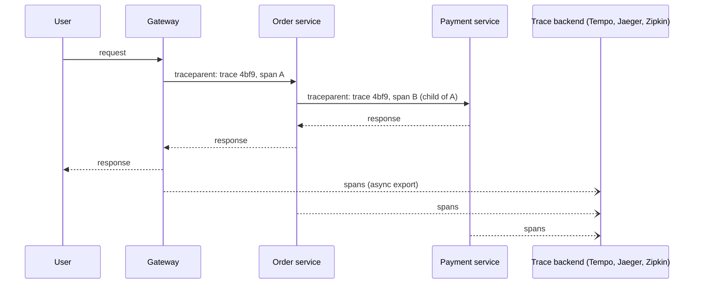
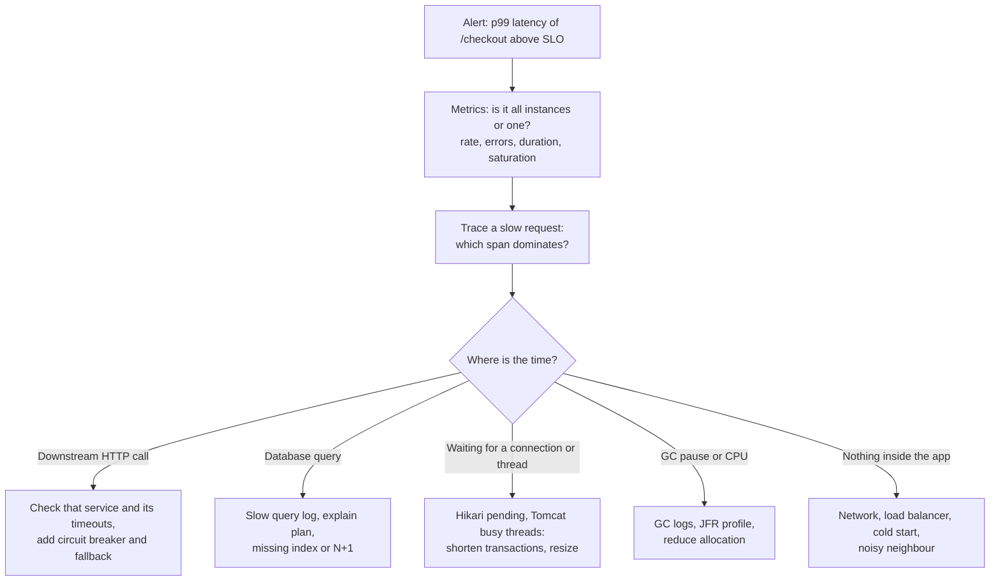

## Beginner

### Q: What is Spring Boot Actuator and which endpoints matter most? {theory}
Actuator adds **production-ready operational endpoints** to your app (`spring-boot-starter-actuator`). Endpoints are available over HTTP (under `/actuator`) and JMX.

| Endpoint | Purpose |
|---|---|
| `/health` | Is the app (and its dependencies) healthy; used by load balancers and Kubernetes |
| `/info` | Build and git info |
| `/metrics` | Micrometer metrics (JVM, HTTP, pool, custom) |
| `/prometheus` | Metrics in Prometheus format (with `micrometer-registry-prometheus`) |
| `/loggers` | View and **change log levels at runtime** |
| `/env`, `/configprops` | Effective configuration (sensitive) |
| `/beans`, `/mappings`, `/conditions` | What is wired and why |
| `/threaddump`, `/heapdump` | Diagnostics (very sensitive) |

Only `health` is exposed over HTTP by default. Expose more deliberately: `management.endpoints.web.exposure.include=health,info,prometheus`.

### Q: How do you secure Actuator endpoints? {coding}
Treat them as an admin surface: heap dumps and `env` can leak secrets.

```properties
management.endpoints.web.exposure.include=health,info,prometheus
management.endpoint.health.show-details=when-authorized
management.server.port=9090                  # separate management port, not exposed publicly
management.endpoint.env.show-values=never     # hide values (Boot 3.x; sanitized by default)
```

```java
@Bean
SecurityFilterChain actuator(HttpSecurity http) throws Exception {
    http.securityMatcher(EndpointRequest.toAnyEndpoint())
        .authorizeHttpRequests(a -> a
            .requestMatchers(EndpointRequest.to("health", "info", "prometheus")).permitAll()
            .anyRequest().hasRole("OPS"))
        .httpBasic(Customizer.withDefaults());
    return http.build();
}
```

Best practice: expose the minimum, move management to an internal port reachable only by the platform (Prometheus, Kubernetes), and require authentication for everything sensitive.

### Q: How do you write a custom health indicator? {coding}
Implement `HealthIndicator`; the bean name (minus `HealthIndicator`) becomes the component name in `/health`.

```java
@Component
class PaymentGatewayHealthIndicator implements HealthIndicator {
    private final PaymentClient client;
    PaymentGatewayHealthIndicator(PaymentClient client) { this.client = client; }

    @Override
    public Health health() {
        try {
            long ms = client.ping();                       // a cheap call with a short timeout
            return Health.up().withDetail("latencyMs", ms).build();
        } catch (Exception ex) {
            return Health.down(ex).withDetail("gateway", "unreachable").build();
        }
    }
}
```

```json
{ "status": "DOWN", "components": { "db": {"status": "UP"}, "paymentGateway": {"status": "DOWN"} } }
```

Careful: a health check that fails when an **optional** downstream is down can make Kubernetes restart healthy pods, or a load balancer remove all instances at once. Keep readiness limited to what the instance truly needs to serve traffic.

## Intermediate

### Q: What are liveness and readiness probes in Kubernetes and how does Boot support them? {theory}
- **Liveness:** "is the process stuck?" If it fails, Kubernetes **restarts** the container.
- **Readiness:** "can it serve traffic now?" If it fails, the pod is **removed from the Service endpoints** but not restarted.
- **Startup probe:** gives slow starters time before liveness applies.

Boot 2.3+ exposes `/actuator/health/liveness` and `/actuator/health/readiness`, enabled automatically on Kubernetes (or with `management.endpoint.health.probes.enabled=true`). They reflect the **availability state** of the app: readiness goes `OUT_OF_SERVICE` during startup and while shutting down gracefully.

```yaml
livenessProbe:
  httpGet: { path: /actuator/health/liveness, port: 8080 }
  initialDelaySeconds: 20
readinessProbe:
  httpGet: { path: /actuator/health/readiness, port: 8080 }
```

Rule of thumb: **liveness must not depend on external systems** (a database outage must not restart every pod), whereas readiness may include essentials. You can change state yourself with `AvailabilityChangeEvent.publish(...)`.

### Q: How do you define custom metrics with Micrometer? {coding}
Micrometer is the metrics facade (like SLF4J for metrics); Boot auto-instruments HTTP, JVM, datasource, caches and more. Add custom meters through `MeterRegistry`.

```java
@Service
class OrderService {
    private final Counter placed;
    private final Timer paymentTimer;

    OrderService(MeterRegistry registry, OrderRepository repo) {
        this.placed = Counter.builder("orders.placed").tag("channel", "web").register(registry);
        this.paymentTimer = Timer.builder("orders.payment.latency")
                                 .publishPercentileHistogram()
                                 .register(registry);
        Gauge.builder("orders.pending", repo, OrderRepository::countPending).register(registry);
    }

    public void place(Order o) {
        paymentTimer.record(() -> gateway.charge(o));
        placed.increment();
    }
}
```

Types: **Counter** (only goes up), **Gauge** (current value), **Timer** (latency and count), **DistributionSummary** (sizes). Keep tag **cardinality low**: never tag by user id or request id, or the metrics backend explodes. Simple alternative: `@Timed` / `@Observed` annotations.

### Q: How do logging and tracing work across services in Boot 3? {theory}
Boot 3 replaced Spring Cloud Sleuth with **Micrometer Tracing** and the **Observation API**: one instrumentation point produces metrics and traces. Add `spring-boot-starter-actuator`, `micrometer-tracing-bridge-otel` (or Brave) and an exporter (OTLP, Zipkin).



The **trace id** travels in the W3C `traceparent` header through `RestClient`, `WebClient` and messaging, and is placed in the **MDC**, so every log line can carry it:

```properties
management.tracing.sampling.probability=0.1
logging.pattern.level=%5p [${spring.application.name:},%X{traceId:-},%X{spanId:-}]
logging.structured.format.console=ecs     # structured JSON logs (Boot 3.4+)
```

Use structured (JSON) logs shipped to a central store, and link logs, metrics and traces by trace id.

## Experienced

### Q: Users report the checkout API is slow, but only sometimes. How do you diagnose it in production? {scenario}


Method: start with the **RED** (rate, errors, duration) and **USE** (utilization, saturation, errors) views; use **tracing** to locate the slow span; correlate with logs by trace id; then confirm with the specific tool (thread dump, `jcmd`/JFR, `EXPLAIN ANALYZE`). Check what changed (deploy, traffic, data growth, dependency version). After the fix, add a metric or alert that would have caught it, and a load test that reproduces it.

### Q: Which metrics and alerts would you set for a Spring Boot service, and how do you avoid alert fatigue? {design}
Use the **four golden signals** plus runtime internals.

- **Latency:** `http.server.requests` p95/p99 per endpoint (histogram buckets).
- **Traffic:** requests per second.
- **Errors:** 5xx ratio, and business errors (failed payments).
- **Saturation:** CPU, memory, JVM heap and GC time, `tomcat.threads.busy`, `hikaricp.connections.pending`, thread-pool queue length, consumer lag for Kafka.
- **Dependencies:** circuit breaker state (`resilience4j.circuitbreaker.state`), downstream latency.

Alert on **symptoms tied to SLOs** (for example error budget burn rate: 2% of the monthly budget burnt in an hour), not on every cause. Page for user-visible impact; send non-urgent signals (disk 70% full, one pod restarted) to a ticket queue. Add runbook links to every alert, and review noisy alerts weekly. Dashboards per service with the same layout let anyone on call orient quickly.

### Q: How do you change log levels or take diagnostics from a live production instance safely? {coding}
Use the `loggers` endpoint to raise verbosity for one package temporarily without a redeploy, then revert.

```bash
# enable DEBUG for one package on a running instance
curl -X POST -H "Content-Type: application/json" \
     -d '{"configuredLevel": "DEBUG"}' \
     http://app:9090/actuator/loggers/com.shop.payment

# revert
curl -X POST -H "Content-Type: application/json" -d '{"configuredLevel": null}' \
     http://app:9090/actuator/loggers/com.shop.payment
```

For deeper diagnostics: `/actuator/threaddump` to see blocked threads, **Java Flight Recorder** (`jcmd <pid> JFR.start duration=60s filename=rec.jfr`) for low-overhead profiling, and `/actuator/heapdump` only when necessary (it pauses the JVM and the file may contain secrets, so store and delete it carefully). Do all of this on the management port with authentication, record who changed what, and avoid enabling DEBUG on high-volume code paths for long.
