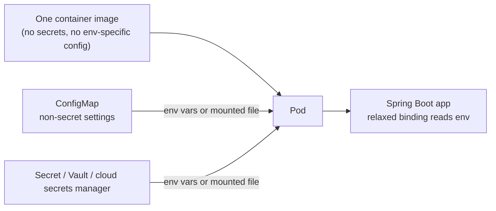
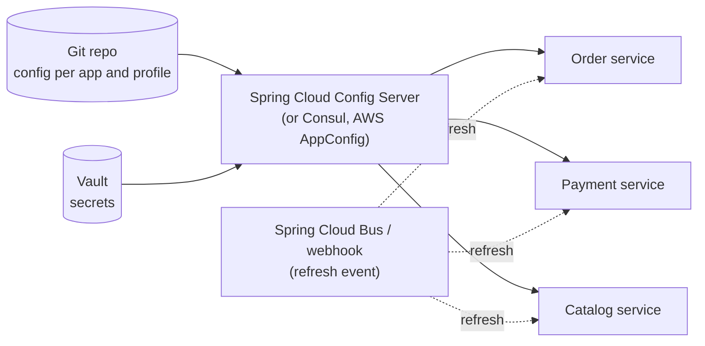

## Beginner

### Q: What is the difference between application.properties and application.yml? {theory}
Both configure the app and are read by the same mechanism; they differ only in format. YAML is hierarchical and avoids repeating prefixes; `.properties` is flat and simple. Use one consistently (if both exist, `.properties` takes precedence over `.yml` in the same location).

```properties
# application.properties
server.port=8081
spring.datasource.url=jdbc:postgresql://localhost:5432/shop
spring.datasource.username=shop
```

```yaml
# application.yml (same settings)
server:
  port: 8081
spring:
  datasource:
    url: jdbc:postgresql://localhost:5432/shop
    username: shop
```

YAML pitfalls: indentation errors, and quoting values that YAML would reinterpret (`on`, `no`, `1.10`, strings starting with `*`). YAML also allows several documents in one file separated by `---` with `spring.config.activate.on-profile`.

### Q: What are Spring profiles and how do you use them? {coding}
Profiles let you vary beans and configuration per environment (`dev`, `test`, `prod`).

```properties
# activate: application.properties, env var, or command line
spring.profiles.active=dev
# SPRING_PROFILES_ACTIVE=prod   |   java -jar app.jar --spring.profiles.active=prod
```

- **Profile-specific files:** `application-dev.yml`, `application-prod.yml` are loaded in addition to `application.yml` and override it.
- **Profile-specific beans:**

```java
@Configuration
class StorageConfig {
    @Bean @Profile("dev")
    FileStorage localStorage() { return new LocalDiskStorage(); }

    @Bean @Profile("!dev")                       // every profile except dev
    FileStorage s3Storage(S3Client s3) { return new S3Storage(s3); }
}
```

- **Profile groups** (`spring.profiles.group.prod=prod-db,prod-security`) activate a set together.

Do not put production secrets in profile files committed to source control; see the externalized configuration questions.

### Q: What is the difference between @Value and @ConfigurationProperties? Show both. {coding}
`@Value` injects a single property (supports SpEL and defaults). `@ConfigurationProperties` binds a **group of related properties** to a typed object, with relaxed binding, validation and IDE metadata.

```java
// @Value: fine for one or two values
@Service
class Mailer {
    Mailer(@Value("${mail.from:noreply@shop.com}") String from) { ... }
}

// @ConfigurationProperties: preferred for structured settings
@ConfigurationProperties(prefix = "shop.payment")
@Validated
public record PaymentProperties(
    @NotBlank String apiUrl,
    @DefaultValue("3") @Min(1) int maxRetries,
    @DefaultValue("2s") Duration timeout,
    List<String> allowedCurrencies) {}

@SpringBootApplication
@ConfigurationPropertiesScan          // or @EnableConfigurationProperties(PaymentProperties.class)
class App {}
```

```yaml
shop:
  payment:
    api-url: https://pay.example.com
    max-retries: 5
    timeout: 3s
    allowed-currencies: [USD, EUR]
```

Advantages of `@ConfigurationProperties`: type conversion (`Duration`, `DataSize`), constructor binding with records (immutable), fail-fast validation at startup, relaxed binding (`api-url`, `apiUrl`, `API_URL` all work) and generated metadata with `spring-boot-configuration-processor`.

## Intermediate

### Q: What is the order of precedence for property sources? {theory}
Later sources override earlier ones. The important order, from **highest to lowest** priority:

1. Command-line arguments (`--server.port=9000`)
2. `SPRING_APPLICATION_JSON` and Java system properties (`-Dserver.port=9000`)
3. **OS environment variables** (`SERVER_PORT=9000`)
4. Profile-specific config files outside the jar, then inside the jar (`application-prod.yml`)
5. General config files outside the jar, then inside the jar (`application.yml`)
6. `@PropertySource` on `@Configuration` classes
7. Default properties (`SpringApplication.setDefaultProperties`)

Practical consequence: the **same jar** is configured per environment by environment variables or an external config file, without rebuilding. Config file locations are searched in order: `classpath:/`, `classpath:/config/`, `./`, `./config/`, then `./config/*/`, with later locations winning. Add more with `spring.config.import` (for example `optional:file:/etc/shop/` or `configserver:`).

### Q: How do you configure an application in Docker and Kubernetes, and handle secrets? {scenario}
Follow the **twelve-factor** rule: config lives in the environment, not in the image.



- **Environment variables** use relaxed binding: `SPRING_DATASOURCE_URL`, `SHOP_PAYMENT_MAX_RETRIES` map to the properties.
- **ConfigMap** mounted as a file (`/config/application.yml`) and loaded with `spring.config.import=optional:file:/config/` or Kubernetes `configtree:` for one-file-per-secret mounts (`spring.config.import=optional:configtree:/run/secrets/`).
- **Secrets:** Kubernetes Secrets (base64 is not encryption; enable encryption at rest), or better an external manager (HashiCorp Vault, AWS Secrets Manager, Azure Key Vault) with short-lived credentials.
- Never bake credentials into the image or the repository, never log property values, and restrict `/actuator/env` (Boot masks known sensitive keys, but do not rely on that alone).

### Q: How do you validate configuration at startup, and why is it worth it? {coding}
Add `@Validated` on the properties class with Bean Validation constraints (needs `spring-boot-starter-validation`). If a value is missing or invalid, the application **fails to start with a clear message** instead of failing later in production.

```java
@ConfigurationProperties(prefix = "shop.mail")
@Validated
public record MailProperties(
    @NotBlank String host,
    @Min(1) @Max(65535) int port,
    @Email String from) {}
```

```text
***************************
APPLICATION FAILED TO START
***************************
Binding to target ... failed:
    Property: shop.mail.port
    Value: "0"
    Reason: must be greater than or equal to 1
```

Fail fast is operationally valuable: a bad rollout is detected by the readiness check during deployment, not by customers.

### Q: How do you enable beans or features conditionally (feature toggles)? {coding}
Use `@Conditional*` annotations for **startup-time** switches.

```java
@Configuration
class FeatureConfig {

    @Bean
    @ConditionalOnProperty(name = "feature.recommendations", havingValue = "true")
    RecommendationService recommendations() { return new MlRecommendationService(); }

    @Bean
    @ConditionalOnMissingBean(RecommendationService.class)     // fallback when the feature is off
    RecommendationService noop() { return new NoopRecommendationService(); }
}
```

These are evaluated once at startup, so flipping the property needs a restart. For **runtime** toggles (gradual rollout, kill switch) use a feature-flag system (Unleash, LaunchDarkly, Togglz, Spring Cloud Config with `@RefreshScope`) and check the flag at call time.

## Experienced

### Q: Design centralized configuration for 30 microservices with secrets, auditing and no-restart updates. {design}


- **Source of truth in Git:** reviews, history and rollback. Secrets are not committed: Config Server resolves them from **Vault** (or services read the secrets manager directly).
- **Bootstrap:** `spring.config.import=optional:configserver:https://config.internal`; secure the server with authentication and TLS; encrypt sensitive values (`{cipher}...`).
- **Dynamic refresh:** `@RefreshScope` beans are rebuilt on `POST /actuator/refresh` (or a Spring Cloud Bus event for all instances). It only refreshes `@ConfigurationProperties` and `@RefreshScope` beans, not everything (a `DataSource` still needs a restart).
- **Resilience:** services must start if the config server is down: keep sane defaults or a cached copy and use `optional:`.
- **Kubernetes alternative:** ConfigMaps/Secrets plus a rolling restart is often simpler than running Config Server; choose the lighter option that satisfies your audit and rollout needs.

### Q: The same artifact must run in dev, staging and prod. What do you keep in the build vs outside it? {scenario}
**Build once, deploy many.** The artifact must be identical across environments; only configuration changes.

- **In the artifact:** code, default (safe, non-secret) properties in `application.yml`, profile files only for *structural* differences (which beans exist), and nothing environment-specific such as hostnames or credentials.
- **Outside the artifact:** URLs, credentials, feature flags, pool sizes, log levels, supplied through environment variables, mounted files, a config server or a secrets manager.
- Verify with the same pipeline: run the identical image through test, staging and production; promote by tag, never rebuild per environment (a rebuild is a different artifact, so what you tested is not what you ship).
- Guard against drift: keep config in version control, validate it at startup (`@Validated`), and print the effective non-secret configuration at startup (Actuator `configprops`/`env`, secured) to compare environments.
