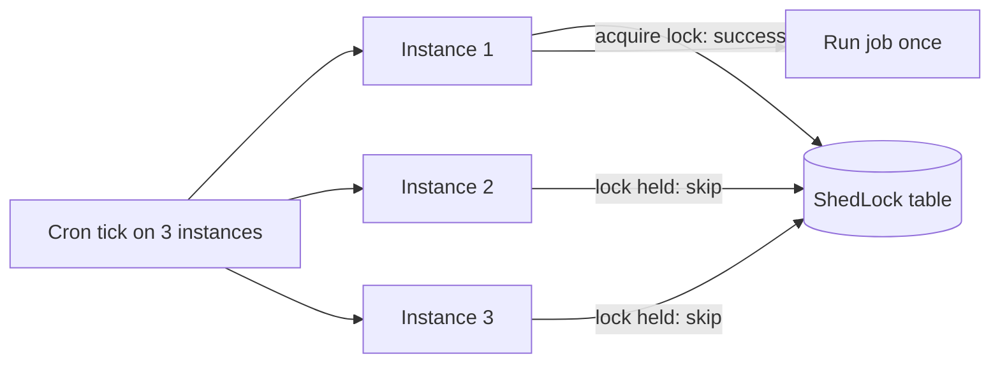
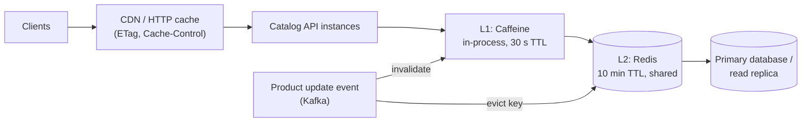
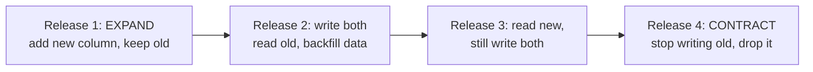

## Beginner

### Q: How does Spring Boot auto-configure a DataSource and connection pool? {theory}
When a JDBC driver (and a starter such as `spring-boot-starter-data-jpa`) is on the classpath and `spring.datasource.url` is set, Boot creates a `DataSource` bean. The pool is **HikariCP** by default (Tomcat JDBC, DBCP2 and Oracle UCP are fallbacks). With an embedded database (H2, HSQL, Derby) and no URL, Boot creates an in-memory one automatically, which is handy for tests but a surprising default in production.

```yaml
spring:
  datasource:
    url: jdbc:postgresql://db:5432/shop
    username: ${DB_USER}
    password: ${DB_PASSWORD}
    hikari:
      maximum-pool-size: 15
      connection-timeout: 5000
```

Boot also configures `JdbcTemplate`, a `DataSourceTransactionManager` or `JpaTransactionManager`, and the JPA `EntityManagerFactory`. Define your own `DataSource` bean and the auto-configuration backs off.

### Q: What does spring.jpa.hibernate.ddl-auto do and what should you use in production? {theory}
It tells Hibernate whether to manage the schema at startup:

| Value | Effect |
|---|---|
| `none` | Do nothing |
| `validate` | Check that entities match the schema, fail if not |
| `update` | Add missing tables/columns (never drops); unpredictable |
| `create` | Drop and recreate at startup |
| `create-drop` | Create at startup, drop on shutdown |

Defaults: `create-drop` for embedded databases, `none` otherwise. In production use `none` or `validate` and manage the schema with **versioned migrations** (Flyway or Liquibase). `update` cannot rename or drop, cannot be reviewed, and can differ between environments.

### Q: How do you add caching with @Cacheable? {coding}
Enable caching and annotate methods; Boot auto-configures a `CacheManager` (a simple in-memory map by default, Caffeine or Redis if configured).

```java
@Configuration
@EnableCaching
class CacheConfig {}

@Service
class ProductService {

    @Cacheable(cacheNames = "products", key = "#id")
    public Product get(Long id) { return repo.findById(id).orElseThrow(); }      // runs only on a cache miss

    @CachePut(cacheNames = "products", key = "#result.id")
    public Product update(Product p) { return repo.save(p); }                    // always runs, refreshes the cache

    @CacheEvict(cacheNames = "products", key = "#id")
    public void delete(Long id) { repo.deleteById(id); }                         // removes the entry
}
```

Caching is implemented with AOP proxies, so the self-invocation rule applies (a call from another method of the same class is not cached). Cached objects must be serializable for distributed caches, and cache **immutable DTOs**, not JPA entities.

## Intermediate

### Q: How do you manage database schema changes with Flyway or Liquibase? {coding}
Add `flyway-core` (plus `flyway-database-postgresql` for recent Flyway versions). Boot runs pending migrations at startup, before JPA validation.

```text
src/main/resources/db/migration/
  V1__create_orders.sql
  V2__add_order_status.sql
  V3__index_orders_by_customer.sql
```

```sql
-- V2__add_order_status.sql
ALTER TABLE orders ADD COLUMN status VARCHAR(20) NOT NULL DEFAULT 'NEW';
CREATE INDEX idx_orders_status ON orders(status);
```

Rules: migrations are **immutable once applied** (Flyway checks checksums; fix forward with a new version), named `V<version>__<description>.sql`, and reviewed like code. `R__` files are repeatable (views, procedures). Liquibase offers the same idea with changelogs in XML/YAML and rollback support. In a multi-instance deployment, the migration lock makes sure only one instance applies changes; for large clusters run migrations as a separate pre-deploy job.

### Q: How would you configure Redis as a distributed cache with TTLs and JSON serialization? {coding}
```java
@Configuration
@EnableCaching
class RedisCacheConfig {

    @Bean
    RedisCacheManager cacheManager(RedisConnectionFactory cf) {
        RedisCacheConfiguration defaults = RedisCacheConfiguration.defaultCacheConfig()
            .entryTtl(Duration.ofMinutes(10))                           // always set a TTL
            .disableCachingNullValues()
            .serializeValuesWith(RedisSerializationContext.SerializationPair
                .fromSerializer(new GenericJackson2JsonRedisSerializer()));   // JSON, not Java serialization

        return RedisCacheManager.builder(cf)
            .cacheDefaults(defaults)
            .withCacheConfiguration("products", defaults.entryTtl(Duration.ofHours(1)))
            .withCacheConfiguration("prices",   defaults.entryTtl(Duration.ofSeconds(30)))
            .build();
    }
}
```

```properties
spring.data.redis.host=redis
spring.data.redis.timeout=500ms
```

Choices to explain: per-cache TTLs match how stale each data type may be; JSON avoids class-version problems of Java serialization; a short **Redis timeout** and a fallback to the database prevent a cache outage from taking the app down (handle with a custom `CacheErrorHandler`). Use **Caffeine** (in-process) for small hot data and Redis when many instances must share a cache; a two-level cache combines both.

### Q: What are the common caching problems and how do you handle them? {scenario}
- **Stale data:** the cache holds old values after the database changed. Fix: TTLs, `@CacheEvict`/`@CachePut` on writes, or event-driven invalidation.
- **Cache stampede (thundering herd):** a hot key expires and thousands of requests hit the database together. Fix: `@Cacheable(sync = true)` (one loader per key per instance), jittered TTLs, request coalescing, or refresh-ahead.
- **Cache penetration:** requests for keys that do not exist bypass the cache every time. Fix: cache the "not found" result with a short TTL, or use a Bloom filter.
- **Hot key:** one key overloads a Redis shard. Fix: local in-process cache in front, replicate the key.
- **Inconsistency between cache and database on failure:** write the database first, then evict/update the cache; accept brief staleness or use a transactional outbox/CDC for invalidation.

```java
@Cacheable(cacheNames = "products", key = "#id", sync = true)    // only one thread loads a missing key
public Product get(Long id) { ... }
```

Always monitor hit ratio and eviction counts; a cache with a low hit ratio is just extra latency.

### Q: How do you configure two databases in one Spring Boot application? {coding}
Boot auto-configures one `DataSource`. For two, define beans explicitly, mark one `@Primary`, and point each repository package to its own `EntityManagerFactory` and transaction manager.

```java
@Configuration
@EnableJpaRepositories(basePackages = "com.shop.orders",
    entityManagerFactoryRef = "ordersEmf", transactionManagerRef = "ordersTm")
class OrdersDbConfig {

    @Bean @Primary
    @ConfigurationProperties("app.datasource.orders")
    DataSourceProperties ordersProps() { return new DataSourceProperties(); }

    @Bean @Primary
    DataSource ordersDataSource() { return ordersProps().initializeDataSourceBuilder().build(); }

    @Bean @Primary
    LocalContainerEntityManagerFactoryBean ordersEmf(EntityManagerFactoryBuilder b,
                                                      @Qualifier("ordersDataSource") DataSource ds) {
        return b.dataSource(ds).packages("com.shop.orders").persistenceUnit("orders").build();
    }

    @Bean @Primary
    PlatformTransactionManager ordersTm(@Qualifier("ordersEmf") EntityManagerFactory emf) {
        return new JpaTransactionManager(emf);
    }
}
// repeat for "reports" with its own package, beans and refs (no @Primary)
```

Remember `@Transactional("ordersTm")` to pick the manager, and that a single `@Transactional` cannot span two databases atomically (use sagas or a distributed transaction manager only when truly needed).

## Experienced

### Q: Your @Scheduled job runs on every instance and sends duplicate emails. How do you fix it? {scenario}
`@Scheduled` runs on **each** instance, so three replicas run the job three times. Options:

1. **Distributed lock** with **ShedLock**: a lock row (JDBC, Redis, Mongo) ensures only one instance executes a run.
2. A dedicated worker deployment (one replica, or a Kubernetes `CronJob`) for schedules.
3. Make the job **idempotent** regardless (claim rows with `update ... where status = 'PENDING'` returning the rows you won, or `SELECT ... FOR UPDATE SKIP LOCKED`), so duplicates are harmless.

```java
@Scheduled(cron = "0 0 * * * *")
@SchedulerLock(name = "sendDigest", lockAtMostFor = "PT50M", lockAtLeastFor = "PT5M")
public void sendDigest() { ... }
```



Set `lockAtMostFor` above the job's normal duration so a crashed instance does not hold the lock forever. For heavy or restartable work prefer Spring Batch or a queue with competing consumers over a cron loop.

### Q: Design the caching layer for a product catalog read by 20,000 requests/second with infrequent updates. {design}


- Serve most traffic from the **edge** (CDN and HTTP caching headers), then a small in-process L1 cache (nanosecond hits), then shared Redis L2, then the database.
- **Invalidation:** writes publish a product-changed event; consumers evict L2 and L1 keys. Short TTLs bound staleness if an event is lost.
- **Protect the database:** `sync = true` or single-flight loading, jittered TTLs, a negative cache for unknown ids, and a circuit breaker so a Redis outage degrades to the database instead of failing.
- **Numbers:** at 20,000 rps with a 95% hit ratio, the database sees about 1,000 rps; 99% means 200 rps. State the hit-ratio target and measure it.
- **Consistency:** this design is eventually consistent; for price or stock at checkout, re-read from the source of truth.

### Q: How do you roll out a breaking schema change (rename a column) with zero downtime? {scenario}
During a rolling deployment old and new code versions run **at the same time** against one database, so a single-step rename would break the old instances. Use the **expand and contract** pattern across several releases:



1. **Expand:** add `full_name` (nullable). Old code ignores it.
2. **Dual write and backfill:** deploy code that writes both columns; backfill existing rows in small batches.
3. **Switch reads** to the new column once data is verified.
4. **Contract:** after all instances run the new code, drop the old column in a later migration.

Each step is independently deployable and reversible. Avoid long locks (use `CREATE INDEX CONCURRENTLY` on PostgreSQL, online DDL tools on MySQL), keep migrations small, and test them against production-sized data. Flyway runs the SQL; the discipline is in how you sequence releases.
