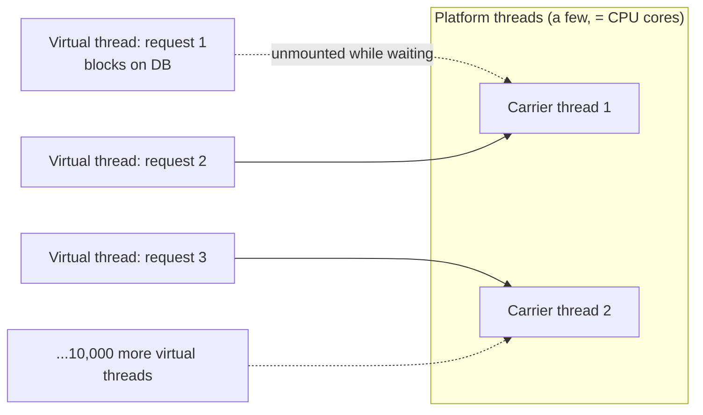
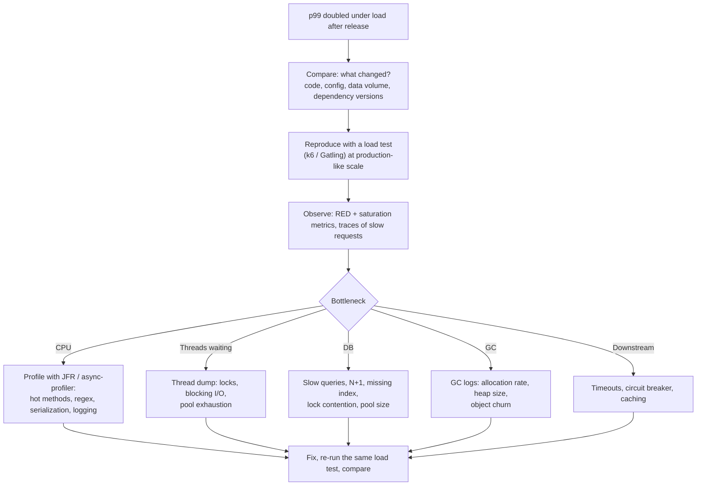
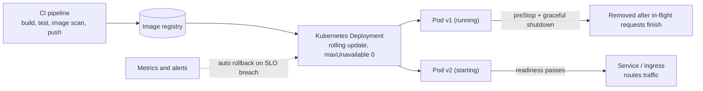
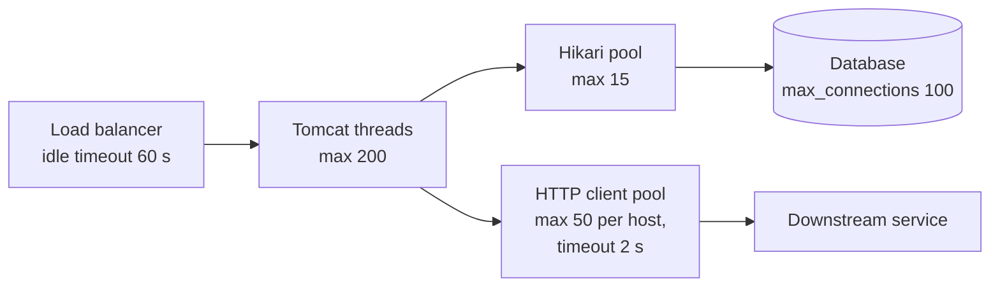

## Beginner

### Q: What is a Spring Boot executable jar and how do you run it? {theory}
Boot's build plugin repackages your app into a **fat (executable) jar**: your classes, all dependency jars (under `BOOT-INF/lib`) and a launcher. Because the web server is embedded, you run it with one command, no application server needed.

```bash
./mvnw clean package            # or ./gradlew bootJar
java -jar target/shop-1.0.0.jar --spring.profiles.active=prod
```

You can still build a **WAR** to deploy into an external servlet container (extend `SpringBootServletInitializer`), but a jar is the norm for containers and cloud. For local development use `spring-boot-devtools` (automatic restart) and `mvn spring-boot:run`.

### Q: How do you containerize a Spring Boot application well? {coding}
Prefer **layered jars** so Docker caches the rarely-changing dependency layer and only rebuilds your small code layer, or let **Cloud Native Buildpacks** do it with no Dockerfile.

```dockerfile
# Multi-stage build with layered jar
FROM eclipse-temurin:21-jre AS builder
WORKDIR /app
COPY target/shop.jar app.jar
RUN java -Djarmode=tools -jar app.jar extract --layers --destination extracted

FROM eclipse-temurin:21-jre
WORKDIR /app
RUN useradd -r -u 1001 appuser                       # do not run as root
COPY --from=builder /app/extracted/dependencies/ ./
COPY --from=builder /app/extracted/spring-boot-loader/ ./
COPY --from=builder /app/extracted/snapshot-dependencies/ ./
COPY --from=builder /app/extracted/application/ ./
USER appuser
EXPOSE 8080
ENTRYPOINT ["java", "-XX:MaxRAMPercentage=75", "-jar", "app.jar"]
```

```bash
./mvnw spring-boot:build-image          # buildpacks: no Dockerfile, sensible JVM memory settings
```

Good practice: pin base image versions, use a slim JRE image, run as a non-root user, keep secrets out of the image, and scan the image for vulnerabilities in CI.

### Q: What is graceful shutdown and why does it matter? {coding}
When a pod is stopped or redeployed, in-flight requests should finish instead of being cut off. Enable it and give it a timeout:

```properties
server.shutdown=graceful
spring.lifecycle.timeout-per-shutdown-phase=30s
```

On `SIGTERM` Boot stops accepting new requests, readiness goes **out of service** so the load balancer stops sending traffic, and active requests are allowed to complete until the timeout. Kubernetes needs `terminationGracePeriodSeconds` larger than that timeout, and many teams add a short `preStop` sleep so endpoint removal propagates before shutdown starts. Also close consumers cleanly (Kafka listeners stop and commit offsets) to avoid reprocessing.

## Intermediate

### Q: How do you configure JVM memory for containers? {theory}
The JVM must respect the container's memory limit; otherwise the OS kills the pod (`OOMKilled`). Modern JVMs (Java 11+) are container-aware.

- Set heap as a **percentage** of container memory: `-XX:MaxRAMPercentage=70` to `75` (leave room for metaspace, thread stacks, direct buffers and native memory). The default of 25% wastes memory.
- Set the **container limit** and request sensibly (for example 1Gi request, 1Gi limit), and CPU requests that match real usage; heavy CPU throttling shows up as latency spikes.
- Pick the collector: **G1** (default) is a good general choice; ZGC or Shenandoah for very low pause needs on larger heaps.
- Tune thread stack size and the number of threads: each platform thread uses memory (about 1 MB of stack by default).

```yaml
resources:
  requests: { cpu: "500m", memory: "1Gi" }
  limits:   { memory: "1Gi" }
env:
  - name: JAVA_TOOL_OPTIONS
    value: "-XX:MaxRAMPercentage=70 -XX:+ExitOnOutOfMemoryError"
```

`ExitOnOutOfMemoryError` lets Kubernetes restart the pod instead of leaving a half-dead JVM. Verify with metrics (`jvm.memory.used`, GC pause time) rather than guessing.

### Q: What are virtual threads and how do you use them in Spring Boot? {theory}
Virtual threads (Java 21, Project Loom) are **lightweight threads managed by the JVM**. A blocking call (JDBC, HTTP, `sleep`) **unmounts** the virtual thread from its carrier thread, so thousands of blocked requests do not consume thousands of OS threads. This gives high concurrency with simple blocking code, without rewriting to reactive.

```properties
# Spring Boot 3.2+, Java 21+
spring.threads.virtual.enabled=true
```

Effects: Tomcat/Jetty handle each request on a virtual thread; `@Async`, `@Scheduled` and Kafka listeners use virtual-thread executors where configured.



Cautions: **bounded resources still matter** (a 10-connection database pool still limits throughput, so protect it); avoid **pinning** (long `synchronized` blocks or native calls holding the carrier; prefer `ReentrantLock`); do not pool virtual threads; and `ThreadLocal`-heavy code costs memory. It helps I/O-bound workloads, not CPU-bound ones.

### Q: What is a GraalVM native image, and what are the trade-offs? {theory}
A native image compiles your app **ahead of time** into a standalone executable (using Spring AOT processing plus GraalVM `native-image`), with no JVM at runtime.

- **Pros:** start in tens of milliseconds, much lower memory (RSS), smaller attack surface; ideal for serverless, scale-to-zero and CLI tools.
- **Cons:** slow, memory-hungry builds; a **closed-world** assumption, so reflection, proxies, resources and serialization need hints (Spring generates most, libraries may not); fewer runtime diagnostics (no JVMTI agents, limited JFR/heap tools); peak throughput can be lower than a warmed-up JIT.

```bash
./mvnw -Pnative native:compile                 # native executable on the host
./mvnw -Pnative spring-boot:build-image        # native image in a container via buildpacks
```

Decision rule: use native when startup time and memory dominate cost (many small, frequently scaled services); stay on the JVM (possibly with CDS or CRaC) for long-running, throughput-heavy services.

## Experienced

### Q: After a release, p99 latency doubles under load. How do you investigate and fix it? {scenario}


Discipline: change **one thing at a time**, keep the load test and environment identical, and compare **percentiles**, not averages. Roll back first if the SLO is burning, then investigate calmly. Typical culprits: a new N+1 query, an unbounded in-memory cache, a synchronous remote call added to the hot path, excessive logging, a missing timeout, a smaller connection pool after a config change, or a JVM flag not honored in the container. Add the check to the CI performance gate afterward so it cannot regress silently.

### Q: Design a zero-downtime deployment strategy for a stateless Spring Boot service on Kubernetes. {design}


- **Rolling update** with `maxUnavailable: 0` and `maxSurge: 1`: new pods start and become ready before old ones are removed.
- **Readiness probe** gates traffic; a **startup probe** protects slow starters; **graceful shutdown** and a `preStop` sleep drain old pods; **PodDisruptionBudget** keeps capacity during node maintenance.
- **Backward-compatible changes only** (database expand and contract, tolerant readers in APIs and events), because old and new versions overlap.
- **Progressive delivery:** canary or blue/green with a tool such as Argo Rollouts or a service mesh, shifting 5% then 25% then 100% of traffic while watching error rate and latency, with **automatic rollback**.
- **Capacity:** at least 2 replicas across zones (anti-affinity), HPA on CPU or custom metrics (requests per second), resource requests set realistically.
- **Config and secrets** come from the environment, so the same image is promoted unchanged from test to production.

### Q: How do you tune thread pools, connection pools and timeouts so they work together? {scenario}
Think of the request path as a series of **queues with limits**; the smallest limit decides throughput and the way they fail decides stability.



- **Order the timeouts:** client timeout > gateway/LB timeout > service call timeout > database/query timeout. Otherwise upstream gives up while downstream keeps working, wasting capacity.
- **Do not let 200 request threads fight for 15 connections** without a plan: queued threads wait up to `connectionTimeout`, so keep that short (a few seconds) to fail fast instead of piling up.
- **Total connections:** `replicas x pool size` must stay under the database `max_connections` (with headroom for admin and migrations).
- **Bulkhead** per downstream so one slow dependency cannot take all threads; **timeouts and circuit breakers** on every outbound call.
- **Load shedding:** when saturated, reject early (`503` / `429`) rather than queueing until everything times out.
- Validate with a **load test that includes a slow dependency** (inject latency) and watch queue depths: `tomcat.threads.busy`, `hikaricp.connections.pending`, circuit breaker state.
