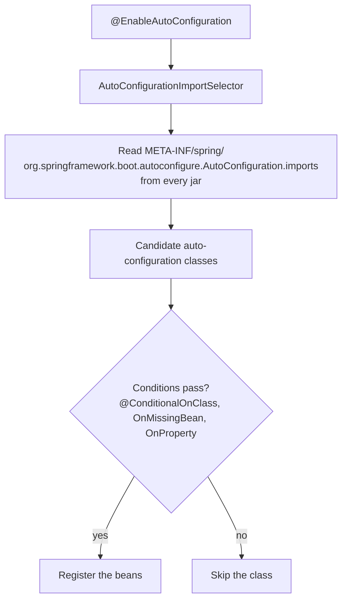
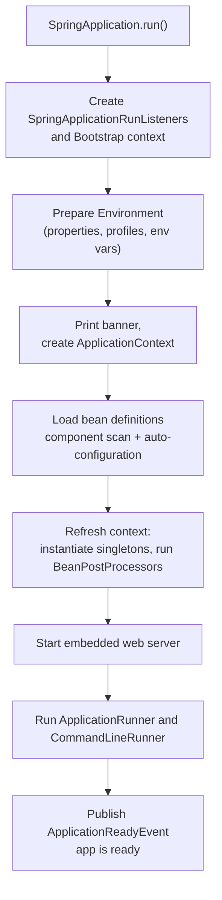
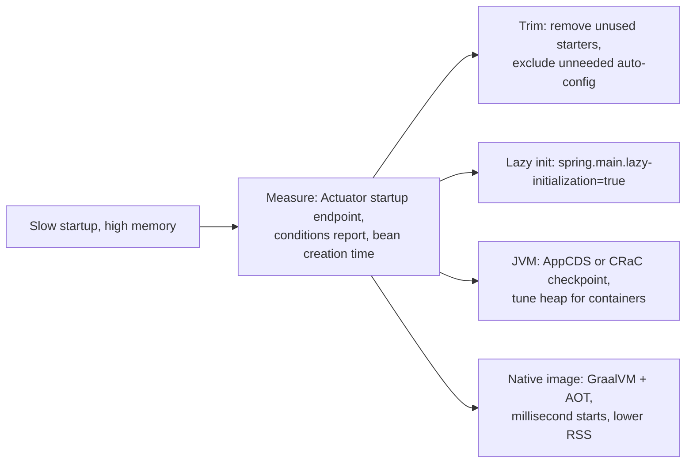

## Beginner

### Q: What is Spring Boot and how is it different from the Spring Framework? {theory}
Spring Framework gives you the building blocks (IoC, MVC, data access, transactions) but expects you to configure them. **Spring Boot** is an opinionated layer on top that removes the boilerplate:

- **Auto-configuration:** sensible beans created for you based on what is on the classpath.
- **Starters:** curated dependency bundles (`spring-boot-starter-web`) with compatible versions managed for you.
- **Embedded server:** a runnable `jar` containing Tomcat/Jetty/Undertow, no WAR deployment needed.
- **Production features:** Actuator (health, metrics), externalized configuration, graceful shutdown.
- **No XML**, and `application.properties`/`yml` for settings.

Boot does not replace Spring; it configures it. You can override any default by defining your own bean or property.

### Q: What does @SpringBootApplication do? {theory}
It is a composed annotation of three:

- `@SpringBootConfiguration`: marks the class as a configuration class (a specialized `@Configuration`).
- `@EnableAutoConfiguration`: turns on auto-configuration.
- `@ComponentScan`: scans the **package of this class and its sub-packages** for `@Component`, `@Service`, `@Repository`, `@Controller`.

```java
@SpringBootApplication
public class ShopApplication {
    public static void main(String[] args) {
        SpringApplication.run(ShopApplication.class, args);
    }
}
```

Because scanning starts at this class's package, place the main class in the **root package** (`com.shop`), with everything else below it. Beans in a sibling package such as `com.other` will not be found unless you add `scanBasePackages`.

### Q: What are Spring Boot starters? Name a few. {theory}
A starter is a **dependency descriptor** (no code) that pulls in a set of libraries for one purpose, with versions managed by Boot's BOM (`spring-boot-dependencies`). You add one line instead of hunting compatible versions.

- `spring-boot-starter-web`: Spring MVC, Jackson, embedded Tomcat.
- `spring-boot-starter-webflux`: reactive web with Netty.
- `spring-boot-starter-data-jpa`: Spring Data JPA, Hibernate, HikariCP.
- `spring-boot-starter-security`, `-validation`, `-actuator`, `-test`, `-cache`, `-aop`, `-amqp`, `-data-redis`.

Naming convention: official starters are `spring-boot-starter-*`; third-party ones use `*-spring-boot-starter`. A custom starter typically bundles an auto-configuration module and the library.

## Intermediate

### Q: How does auto-configuration work internally? {theory}
Auto-configuration classes are normal `@Configuration` classes guarded by **conditions**. Boot lists the candidate classes in a file inside each library jar and, at startup, imports only the ones whose conditions pass.



Key conditions:

- `@ConditionalOnClass`: a library is on the classpath (for example `DataSource`).
- `@ConditionalOnMissingBean`: **back off if the user already defined this bean**, which is how you override defaults.
- `@ConditionalOnProperty`: a property enables or disables a feature.
- `@ConditionalOnWebApplication`, `@ConditionalOnBean`, `@ConditionalOnResource`.

Since Boot 2.7/3.0 the candidates are registered in `META-INF/spring/org.springframework.boot.autoconfigure.AutoConfiguration.imports` (the old `spring.factories` entry is no longer used for this). To see what matched and why, run with `--debug` or `debug=true` and read the **conditions evaluation report**, or use the Actuator `conditions` endpoint.

### Q: Walk through what happens when SpringApplication.run() executes. {theory}


Useful hooks: `CommandLineRunner` / `ApplicationRunner` (run code after startup), `ApplicationReadyEvent` listeners, `EnvironmentPostProcessor` (modify properties before beans exist) and `SpringApplicationBuilder` for customizing the app. The web server starts **during context refresh**, and the app is marked ready only after the runners finish.

### Q: How do you switch the embedded server from Tomcat to Jetty or Undertow, and tune it? {coding}
Exclude Tomcat from the web starter and add the other server's starter.

```xml
<dependency>
  <groupId>org.springframework.boot</groupId>
  <artifactId>spring-boot-starter-web</artifactId>
  <exclusions>
    <exclusion>
      <groupId>org.springframework.boot</groupId>
      <artifactId>spring-boot-starter-tomcat</artifactId>
    </exclusion>
  </exclusions>
</dependency>
<dependency>
  <groupId>org.springframework.boot</groupId>
  <artifactId>spring-boot-starter-jetty</artifactId>
</dependency>
```

Common Tomcat tuning properties:

```properties
server.port=8080
server.tomcat.threads.max=200             # worker threads (thread-per-request)
server.tomcat.accept-count=100            # queue when all threads are busy
server.tomcat.max-connections=8192
server.shutdown=graceful                  # finish in-flight requests on SIGTERM
server.compression.enabled=true
```

Pick the server for features and operational fit; the performance difference rarely matters compared to your own code and downstream calls.

### Q: How do you exclude or override an auto-configuration? {coding}
Three ways, from least to most invasive:

1. **Define your own bean**: most auto-configs use `@ConditionalOnMissingBean`, so yours wins automatically.
2. **Exclude by class or property** when you do not want it at all:

```java
@SpringBootApplication(exclude = { DataSourceAutoConfiguration.class })
public class App { }
```

```properties
spring.autoconfigure.exclude=org.springframework.boot.autoconfigure.jdbc.DataSourceAutoConfiguration
```

3. Turn individual features off with their own properties (`spring.jpa.open-in-view=false`, `management.endpoints.enabled-by-default=false`).

A typical case: an app with a JDBC driver on the classpath but no database fails to start because `DataSourceAutoConfiguration` cannot find a URL. Excluding it (or providing the URL) fixes that.

## Experienced

### Q: How do you create a custom Spring Boot starter for your organization? {coding}
Split into an **auto-configuration module** (the logic) and a **starter module** (an empty pom that depends on it), so consumers add one dependency.

```java
@ConfigurationProperties(prefix = "acme.audit")
public record AuditProperties(boolean enabled, String topic) {}

@AutoConfiguration
@EnableConfigurationProperties(AuditProperties.class)
@ConditionalOnProperty(prefix = "acme.audit", name = "enabled", havingValue = "true", matchIfMissing = true)
public class AuditAutoConfiguration {

    @Bean
    @ConditionalOnMissingBean                 // let services override with their own implementation
    AuditPublisher auditPublisher(AuditProperties props, KafkaTemplate<String, String> kafka) {
        return new KafkaAuditPublisher(kafka, props.topic());
    }
}
```

Register it in `src/main/resources/META-INF/spring/org.springframework.boot.autoconfigure.AutoConfiguration.imports`:

```text
com.acme.audit.AuditAutoConfiguration
```

Guidelines: make everything conditional and overridable, expose settings through `@ConfigurationProperties` (add `spring-boot-configuration-processor` for IDE metadata), do not use component scanning inside a starter, and keep dependencies `optional` where users may not need them. Test with `ApplicationContextRunner`.

### Q: What changed in Spring Boot 3 / Spring Framework 6, and what do you need to migrate? {theory}
- **Java 17 baseline** (Java 21 recommended for virtual threads).
- **Jakarta EE namespace:** `javax.*` became `jakarta.*` (`jakarta.persistence`, `jakarta.servlet`, `jakarta.validation`). Update imports and third-party libraries; tools like OpenRewrite automate this.
- **Spring Security 6:** `WebSecurityConfigurerAdapter` removed (use `SecurityFilterChain`), `authorizeRequests` replaced by `authorizeHttpRequests`, `antMatchers` replaced by `requestMatchers`.
- **Observability** moved to Micrometer Observation and Micrometer Tracing (Sleuth is gone).
- **GraalVM native images** and AOT processing are officially supported.
- `ProblemDetail` (RFC 7807), HTTP interface clients, new auto-configuration registration file, and Hibernate 6.

Migration plan: upgrade to the latest 2.7.x first and fix deprecation warnings, move to Java 17, run the **Spring Boot Migrator / OpenRewrite** recipes, upgrade to 3.x, fix compile errors package by package, then run the full test suite and a performance check.

### Q: Startup is slow and memory use is high in containers. What can you do? {scenario}
Measure first (`--debug`, startup actuator endpoint, `-Xlog:class+load`), then pick levers by size of win.



- Remove unused dependencies and auto-configurations; reduce component-scan breadth.
- `spring.main.lazy-initialization=true` creates beans on first use (faster start, but first requests are slower and configuration errors appear later).
- **Class Data Sharing / AppCDS** and **CRaC** (checkpoint/restore) cut JVM start time without code changes.
- **GraalVM native image** (`./mvnw -Pnative native:compile`) gives start in tens of milliseconds and smaller memory, at the cost of longer builds, reflection hints and some library limits.
- Container sizing: set `-XX:MaxRAMPercentage`, and do not let the JVM guess from the host's memory.

State the trade-off: for long-lived services JIT peak throughput is often better than native; native shines for serverless and scale-to-zero.
