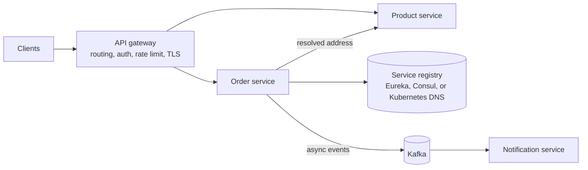
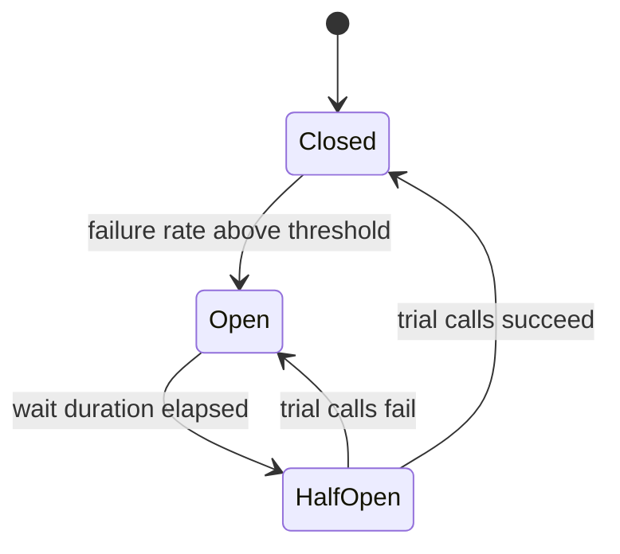
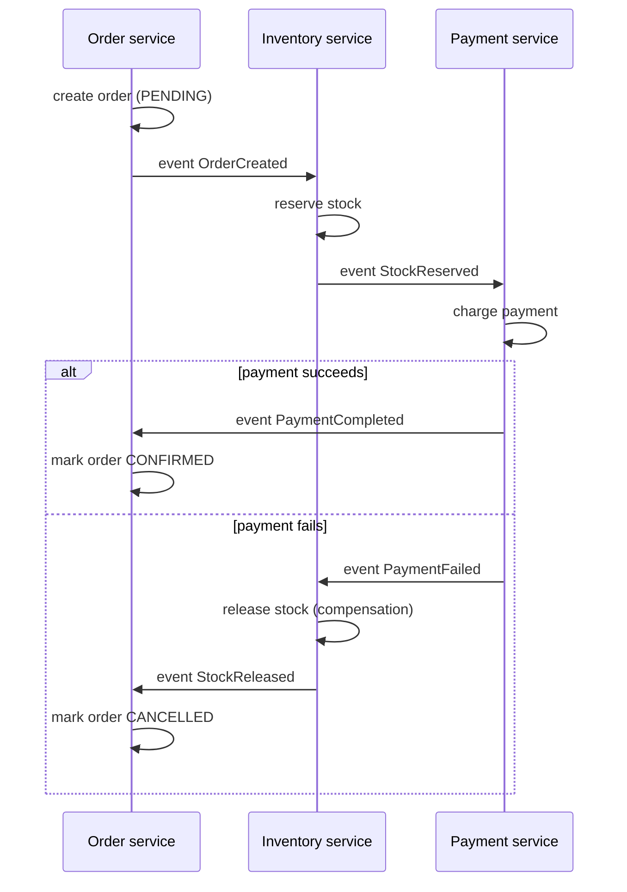
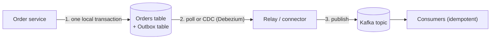
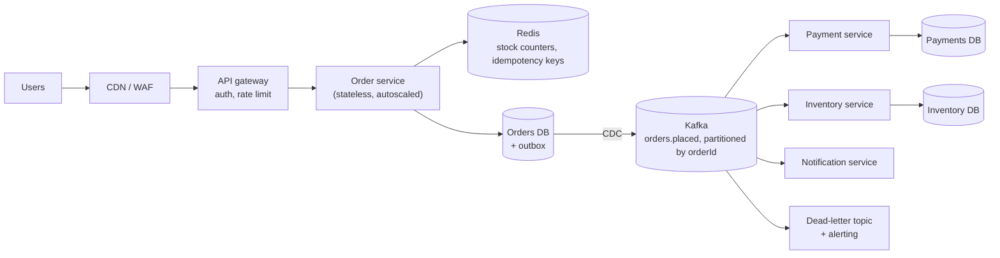
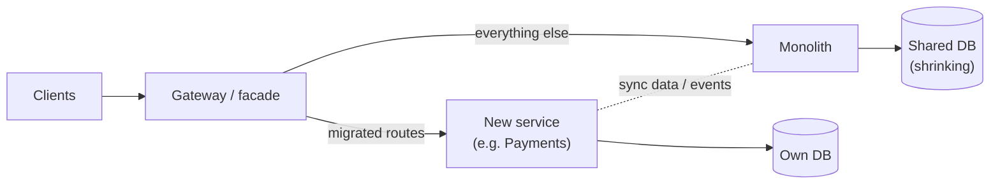

## Beginner

### Q: What are microservices, and when should you not use them? {theory}
Microservices split an application into **small, independently deployable services**, each owning one business capability and its own data, communicating over the network (REST, gRPC, messaging).

Benefits: independent deployment and scaling, team autonomy, fault isolation, freedom to choose technology. Costs: distributed-system complexity (network failures, latency, eventual consistency), harder testing and debugging, operational overhead (CI/CD, observability, service discovery), and data-consistency challenges.

Do **not** start with microservices when the domain is unclear, the team is small, or the product is young. A **well-structured modular monolith** is faster to build and can be split later along the module boundaries. Split when teams block each other, parts need to scale very differently, or release cycles must differ. Rule: *do not pay the distributed-systems tax until you need the benefits.*

### Q: How do you decide service boundaries? {theory}
Use **Domain-Driven Design**: draw boundaries around **bounded contexts** (Orders, Payments, Inventory, Shipping), where terms have one consistent meaning and one team owns the data and rules.

- High cohesion inside a service, **loose coupling** between services.
- Each service owns its **own database**; others access data only through its API or events, never its tables.
- Avoid splitting by technical layer ("UI service", "DB service") and avoid chatty services that need ten calls to answer one request, a sign the boundary is wrong.
- Align with team structure (Conway's law): one team, one or a few services.

### Q: How do services find and call each other? What do API gateway and service discovery do? {theory}


- **API gateway** (Spring Cloud Gateway) is the single entry point: routing, authentication, rate limiting, request transformation, aggregation, and hiding internal topology.
- **Service discovery** lets services find instances whose addresses change (autoscaling, redeploys). Classic Spring Cloud uses Eureka/Consul with client-side load balancing (`@LoadBalanced`, Spring Cloud LoadBalancer). On **Kubernetes** you usually skip Eureka: a `Service` and cluster DNS (`http://payment-service`) do discovery and load balancing for you.

## Intermediate

### Q: How do you make service calls resilient? Explain circuit breaker, retry, timeout and bulkhead. {coding}
Remote calls fail and stall. Without protection one slow dependency can exhaust your threads and cause a **cascading failure**.

- **Timeout:** never wait forever; set connect and read timeouts on every client.
- **Retry:** repeat transient failures with exponential backoff and jitter, only for idempotent operations.
- **Circuit breaker:** after too many failures, **open** and fail fast (or use a fallback) so the struggling service can recover; periodically probe in **half-open**.
- **Bulkhead:** limit concurrent calls per dependency so one cannot consume all threads.
- **Rate limiter / load shedding:** protect yourself from overload.



```java
@Service
class PricingClient {
    private final RestClient rest;
    PricingClient(RestClient rest) { this.rest = rest; }

    @CircuitBreaker(name = "pricing", fallbackMethod = "cached")
    @Retry(name = "pricing")
    @Bulkhead(name = "pricing")
    Price price(String sku) {
        return rest.get().uri("/prices/{sku}", sku).retrieve().body(Price.class);
    }

    Price cached(String sku, Throwable t) { return lastKnownPrices.getOrDefault(sku, Price.unavailable(sku)); }
}
```

```yaml
resilience4j:
  circuitbreaker.instances.pricing:
    sliding-window-size: 20
    failure-rate-threshold: 50
    wait-duration-in-open-state: 10s
  retry.instances.pricing:
    max-attempts: 3
    wait-duration: 200ms
    enable-exponential-backoff: true
```

Use Resilience4j (Spring Cloud CircuitBreaker). Order matters: a typical decoration is Retry wrapping CircuitBreaker wrapping a TimeLimiter/Bulkhead around the call. Always define a **meaningful fallback** (cache, default, degraded response) and monitor breaker state.

### Q: How does Kafka messaging work with Spring Boot, and how do you avoid processing a message twice? {coding}
Producers write to **topics** split into **partitions**; messages with the same key go to the same partition (ordering per key); a **consumer group** shares partitions among its instances. Delivery is **at-least-once** by default, so consumers must be **idempotent**.

```java
@Service
class OrderEventsProducer {
    private final KafkaTemplate<String, OrderPlaced> kafka;
    OrderEventsProducer(KafkaTemplate<String, OrderPlaced> kafka) { this.kafka = kafka; }

    void publish(OrderPlaced e) { kafka.send("orders.placed", e.orderId(), e); }   // key = orderId keeps order per order
}

@Component
class InventoryListener {
    private final ProcessedEventRepository processed;
    private final InventoryService inventory;
    // constructor omitted

    @KafkaListener(topics = "orders.placed", groupId = "inventory")
    @Transactional
    void on(OrderPlaced e) {
        if (!processed.markIfNew(e.eventId())) return;       // unique constraint on eventId: skip duplicates
        inventory.reserve(e.orderId(), e.items());
    }
}
```

```properties
spring.kafka.producer.acks=all
spring.kafka.producer.properties.enable.idempotence=true
spring.kafka.consumer.enable-auto-commit=false
spring.kafka.listener.ack-mode=record
```

Also configure retries with backoff and a **dead-letter topic** (`DefaultErrorHandler` with `DeadLetterPublishingRecoverer`) for poison messages, and watch **consumer lag**. Idempotency means the effect of processing a message twice equals processing it once.

### Q: How do you handle a distributed transaction across Order, Payment and Inventory services? {design}
A single ACID transaction across services' databases is impractical (two-phase commit hurts availability and coupling). Use a **saga**: a sequence of local transactions, each publishing an event, with **compensating actions** to undo earlier steps on failure.



Two styles: **choreography** (services react to each other's events: simple, but the flow is implicit and harder to follow) and **orchestration** (a coordinator, such as an `OrderSaga` or Temporal/Camunda, tells each service what to do: explicit, easier to monitor). Expect **eventual consistency**: model intermediate states (`PENDING`), make every step and compensation **idempotent**, and give users clear status.

## Experienced

### Q: How do you reliably update the database and publish an event without losing either? {scenario}
This is the **dual-write problem**: if you save to the database and then send to Kafka, a crash in between leaves them inconsistent (order saved but no event, or event sent but transaction rolled back).

The **transactional outbox** pattern fixes it: write the event to an `outbox` table **in the same local transaction** as the business data; a separate process reads the outbox and publishes to Kafka.



```java
@Transactional
public void place(Order order) {
    orderRepo.save(order);
    outboxRepo.save(new OutboxEvent(UUID.randomUUID(), "orders.placed", order.getId(), toJson(order)));
}   // commit makes both durable together
```

The relay can be a scheduled poller (with `SKIP LOCKED` and ShedLock) or **Change Data Capture** with Debezium reading the database log (lower latency, no polling load). Delivery is at-least-once, so consumers deduplicate by `eventId`. Delete or archive outbox rows after publishing.

### Q: Design an e-commerce order-processing system that handles 5,000 orders/second at peak (flash sale). {design}


Reasoning:

- **Absorb the spike:** accept the order quickly, persist it as `PENDING`, return `202`, and process payment and fulfillment **asynchronously** through Kafka. The queue smooths bursts.
- **Prevent overselling:** an atomic stock decrement in Redis (`DECR` / Lua script) for the hot path, reconciled to the Inventory database; or a conditional SQL update.
- **Consistency:** saga across services with compensations; outbox for reliable events; idempotency keys on the order API; idempotent consumers.
- **Scale:** stateless order instances behind a load balancer (autoscale on CPU and latency), Kafka partitions sized for parallelism (partition count caps consumer concurrency), database sharding or read replicas as needed, connection pools sized per instance.
- **Resilience:** timeouts, circuit breakers and bulkheads on calls to payment providers, queue-based retry, dead-letter handling, graceful degradation (disable recommendations first).
- **Observability:** trace id through every hop, consumer-lag and queue-depth alerts, order-state dashboards.
- **Capacity check:** 5,000 orders/s with about 3 events per order is roughly 15,000 messages/s, well within a modest Kafka cluster; the database write path (5,000 inserts/s) needs batching, partitioning or sharding.

### Q: How do you migrate a monolith to microservices safely? {scenario}
Use the **strangler fig pattern**: grow the new system around the old one and shrink the monolith gradually, rather than a risky big-bang rewrite.



1. First **modularize inside the monolith** (clear packages, enforce boundaries with ArchUnit or Spring Modulith) so seams exist.
2. Put a **gateway** in front. Pick one capability with clear boundaries and high value or pain (payments, notifications).
3. Build the new service, **route a small share of traffic** (feature flag, canary) and compare results (shadow traffic).
4. **Split the data**: replicate or publish events at first, then move ownership of the tables; avoid two services writing the same table.
5. Retire the old code, repeat for the next capability.

Risks to call out: distributed transactions replacing local ones, increased latency, duplicated data, and the need for observability and automation **before** splitting. Stop when the benefits (independent delivery) no longer justify the cost of further splitting.
