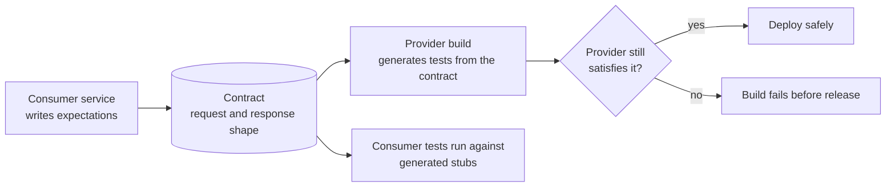

## Beginner

### Q: What is the difference between @SpringBootTest and the test slice annotations? {theory}
- **`@SpringBootTest`** starts the **full application context** (optionally with a real server on a random port). Use it for a few end-to-end integration tests.
- **Test slices** load only the beans for one layer, so they start faster and focus the test:

| Annotation | Loads | Typical use |
|---|---|---|
| `@WebMvcTest(Controller.class)` | MVC layer, filters, converters; **no** services | Controller behavior, validation, JSON, status codes |
| `@DataJpaTest` | JPA repositories, Hibernate, embedded or container DB; transactional | Repository queries, mappings |
| `@JsonTest` | Jackson `ObjectMapper` | Serialization rules |
| `@RestClientTest` | `RestClient`/`RestTemplate` with a mock server | HTTP clients |
| `@WebFluxTest` | Reactive web layer | WebFlux controllers with `WebTestClient` |

The testing pyramid applies: many fast unit tests (no Spring at all), a moderate number of slice tests, and few full-context tests.

### Q: How do you unit test a service without starting Spring? {coding}
Use plain JUnit 5 and Mockito. This is the fastest and most valuable level, and another reason to prefer constructor injection.

```java
@ExtendWith(MockitoExtension.class)
class OrderServiceTest {

    @Mock OrderRepository repo;
    @Mock PaymentGateway gateway;
    @InjectMocks OrderService service;

    @Test
    void placesOrderWhenPaymentSucceeds() {
        when(gateway.charge(any())).thenReturn(PaymentResult.ok("tx-1"));
        when(repo.save(any(Order.class))).thenAnswer(inv -> inv.getArgument(0));

        Order result = service.place(new OrderRequest("sku-1", 2));

        assertThat(result.getStatus()).isEqualTo(OrderStatus.PAID);
        verify(gateway).charge(argThat(r -> r.amount().equals(Money.of(20))));
    }

    @Test
    void doesNotSaveWhenPaymentFails() {
        when(gateway.charge(any())).thenThrow(new PaymentDeclinedException());
        assertThatThrownBy(() -> service.place(new OrderRequest("sku-1", 2)))
            .isInstanceOf(PaymentDeclinedException.class);
        verifyNoInteractions(repo);
    }
}
```

### Q: How do you test a controller with MockMvc? {coding}
`@WebMvcTest` loads only the web layer, so mock the services it calls. In Spring Boot 3.4+ use `@MockitoBean` (Spring Framework 6.2); `@MockBean` is deprecated there but identical in purpose and still common in older code.

```java
@WebMvcTest(BookController.class)
class BookControllerTest {

    @Autowired MockMvc mvc;
    @MockitoBean BookService service;          // @MockBean on Boot 3.3 and earlier

    @Test
    void returnsBook() throws Exception {
        when(service.get(1L)).thenReturn(new BookDto(1L, "Clean Code"));

        mvc.perform(get("/api/v1/books/1").accept(MediaType.APPLICATION_JSON))
           .andExpect(status().isOk())
           .andExpect(jsonPath("$.title").value("Clean Code"));
    }

    @Test
    void rejectsInvalidBody() throws Exception {
        mvc.perform(post("/api/v1/books")
               .contentType(MediaType.APPLICATION_JSON)
               .content("{\"title\":\"\"}"))
           .andExpect(status().isBadRequest())
           .andExpect(jsonPath("$.errors.title").exists());
    }
}
```

## Intermediate

### Q: Why not test repositories with H2, and how do you use Testcontainers instead? {coding}
H2 behaves differently from PostgreSQL/MySQL (SQL dialect, JSON types, locking, sequences, constraints), so tests can pass while production fails. **Testcontainers** runs the real database in a Docker container for the test.

```java
@DataJpaTest
@AutoConfigureTestDatabase(replace = AutoConfigureTestDatabase.Replace.NONE)   // do not swap in H2
@Testcontainers
class OrderRepositoryTest {

    @Container
    @ServiceConnection                                  // Boot 3.1+: wires URL, user and password automatically
    static PostgreSQLContainer<?> postgres = new PostgreSQLContainer<>("postgres:16");

    @Autowired OrderRepository repo;

    @Test
    void findsOrdersByCustomer() {
        repo.save(new Order("c-1", Money.of(10)));
        assertThat(repo.findByCustomerId("c-1")).hasSize(1);
    }
}
```

`@ServiceConnection` replaced the older `@DynamicPropertySource` boilerplate. Run the same Flyway migrations as production, share one container across test classes (static singleton or `withReuse`) to keep the suite fast, and add containers for Kafka, Redis and others the same way.

### Q: How do you test secured endpoints? {coding}
Use the Spring Security test support: `@WithMockUser`, a `jwt()` request post-processor, or `@WithUserDetails`.

```java
@WebMvcTest(AdminController.class)
@Import(SecurityConfig.class)                          // load your real security rules
class AdminControllerTest {

    @Autowired MockMvc mvc;

    @Test
    void anonymousIsUnauthorized() throws Exception {
        mvc.perform(get("/api/admin/users")).andExpect(status().isUnauthorized());
    }

    @Test
    @WithMockUser(roles = "USER")
    void userIsForbidden() throws Exception {
        mvc.perform(get("/api/admin/users")).andExpect(status().isForbidden());
    }

    @Test
    void adminWithJwtIsAllowed() throws Exception {
        mvc.perform(get("/api/admin/users")
               .with(jwt().authorities(new SimpleGrantedAuthority("ROLE_ADMIN"))))
           .andExpect(status().isOk());
    }
}
```

Always test the **negative** paths (anonymous, wrong role, other tenant's data), and for state-changing requests on cookie-authenticated apps include `.with(csrf())`.

### Q: How do you test code that depends on an external REST API or messaging? {coding}
- **HTTP clients:** `@RestClientTest` with `MockRestServiceServer` for unit-level checks, or **WireMock** / MockWebServer for realistic behavior (delays, faults, status codes).
- **Kafka:** Testcontainers Kafka for integration tests, or `@EmbeddedKafka` for lighter ones. Use **Awaitility** to wait for asynchronous results instead of `Thread.sleep`.
- **Time and randomness:** inject a `Clock` and ID generator so tests are deterministic.

```java
@Test
void publishesEventAfterOrderPlaced() {
    service.place(request);

    await().atMost(Duration.ofSeconds(5)).untilAsserted(() -> {
        ConsumerRecord<String, String> rec = KafkaTestUtils.getSingleRecord(consumer, "orders.placed");
        assertThat(rec.value()).contains("sku-1");
    });
}
```

## Experienced

### Q: Your integration test suite takes 25 minutes. How do you speed it up? {scenario}
Find what is slow, then remove cost in order of impact.

1. **Fewer application contexts.** Spring caches the context by configuration; every distinct combination of `@MockitoBean`, `@TestPropertySource`, `@ActiveProfiles` or `@DirtiesContext` creates a **new context** (a slow restart). Standardize a shared base configuration and avoid `@DirtiesContext`.
2. **Right-size the tests.** Replace `@SpringBootTest` with slices or plain unit tests where possible; test business rules without Spring.
3. **Reuse containers** across the suite (static or singleton containers, Testcontainers reuse) and start them in parallel.
4. **Roll back instead of reset.** Use `@Transactional` tests (when the code under test runs in the same thread) or truncate tables quickly, instead of rebuilding the schema.
5. **Parallelize** with JUnit 5 (`junit.jupiter.execution.parallel.enabled=true`) and CI sharding, after making tests independent.
6. Keep slow end-to-end tests in a separate pipeline stage that runs less often.

Use the build scan or surefire timings to see the slowest tests; a handful usually account for most of the time.

### Q: How do you make sure two microservices stay compatible without brittle end-to-end tests? {design}
Use **consumer-driven contract testing** (Spring Cloud Contract or Pact).



- The consumer states what it needs (fields, status codes); the contract is the shared artifact.
- The **provider's build** verifies it still honors every consumer contract, so a breaking change fails in CI instead of production.
- The consumer's tests run against **stubs generated from the contract**, so they stay fast and need no running provider.
- This replaces most cross-service end-to-end tests, which are slow and flaky. Keep a thin set of smoke tests in a real environment.

Pair it with backward-compatible API evolution (add fields, do not remove) and consumer-aware deprecation.

### Q: What would a complete test strategy for a Spring Boot microservice look like? {design}
| Level | Tool | What it proves | Share |
|---|---|---|---|
| Unit | JUnit 5, Mockito, AssertJ | Business rules in isolation | Most |
| Slice | `@WebMvcTest`, `@DataJpaTest`, `@JsonTest` | Layer wiring, queries, JSON, validation | Many |
| Integration | `@SpringBootTest` + Testcontainers | Real DB, messaging, migrations, security together | Some |
| Contract | Spring Cloud Contract / Pact | API compatibility with consumers | Per integration |
| End to end | A few smoke tests in staging | Critical user journeys | Few |
| Non-functional | Gatling/k6, ArchUnit, mutation testing | Performance, architecture rules, test quality | As needed |

Make the pipeline **fast feedback first**: unit and slice tests on every commit, integration and contract tests on every PR, performance and smoke tests before release. Treat flaky tests as bugs (quarantine, then fix), measure coverage on **behavior** (mutation score) rather than chasing a percentage, and keep test data builders and fixtures shared and small.
